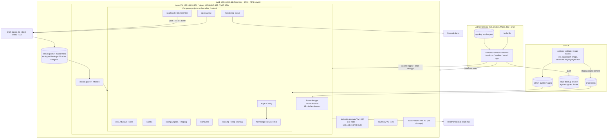
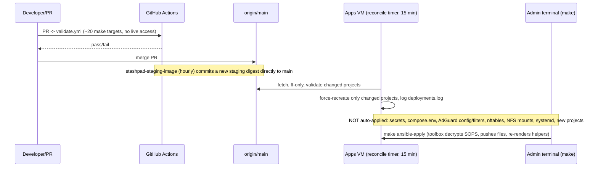
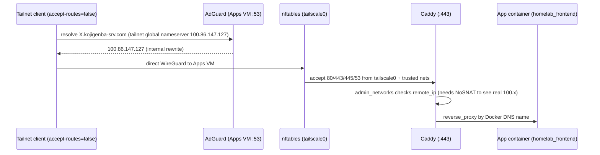

# Codebase Map

> Originally generated by Cartographer; incrementally maintained. Last mapped: 2026-10-12T13:32:10Z
> Source: incremental update through Homepage PRs #82-#84 (code through `447006c`), plus the consolidation of historical docs into `docs/archive/`, on top of the 2026-10-10 full map. `total_files`, `total_tokens` and module token estimates retain that full-map baseline and have not been remeasured. Statements marked *(inferred)* were not verified against a live system. This map describes the repo; live observations cite dated operator checks. Incremental updates also cover stale rollback/example defaults, the host recovery runbook, and the 2026-10-12 checks of pve1, its NFS clients, ElastiFlow and stashPadDev, plus the rebuild assessment and backup decisions.

## 0. Read this first (rules for agents)

- **The repo is infrastructure-as-code for a single-node homelab.** Production = **one Debian 13 "Apps VM" running 11 Docker Compose projects (12 services; counted from `files/services/compose/*/compose.yaml`)** on a Proxmox host (`pve1`). Kubernetes (Kubespray/Flux/MetalLB/cert-manager) was **fully retired on 2026-09-23**; `docs/archive/` holds frozen history; `k8s-volumes` is still an active NFS data path.
- **Merging to `main` is a production deploy for Compose changes.** A systemd timer on the Apps VM fast-forwards `/opt/homelab` from `origin/main` every 15 min and force-recreates the changed projects. Treat any PR touching `files/services/compose/**` as a live change. **New projects need `make ansible-apply` to update the helpers**; new secrets are required only when the project uses them, and explicit startup is needed only if it remains stopped after apply (see §4.1).
- **Never run live operations without explicit user approval:** `make terraform-apply`, `make tailscale-apply`, `make ansible-apply`, `make rollback-app`, `make state-restore`, NFS/ZFS/IX2215 changes, `terraform destroy`. Read-only validation (`make` fixtures/lint/validate) is fine.
- **Do not read or print secrets.** `files/infrastructure/secrets/runtime.sops.yaml` is encrypted (leave it alone); plaintext `runtime.yaml`, `*.tfstate*`, `terraform.tfvars`, `acl-policy.live.json`, `tmp/`, `*.log` (`teraterm.log`, `ts.log` at repo root) are gitignored and may hold sensitive data.
- **Hard "never" list** (from docs): never delete the `state-backup` branch; never delete dataset `tank-gen2/data/k8s-volumes` or its in-use data: retirement preserved 3 app directories (SillyTavern and stashPad prod/staging); `group_vars/apps.yml` now declares a fourth use, Open WebUI; never touch VMID 111 (`stashPadDev`) or 9000 (template); keep ZFS snapshot `@pre-phase5-retire-20260923` until explicitly approved; never remove the `192.168.10.0/24` advertisement from the Tailscale gateway; never copy the age private key to the Apps VM; never rewrite old ADRs (supersede with a new one); never put the sparkDash token, SSH private key or NodeID in docs/commits.
- **No `CLAUDE.md` / `AGENTS.md` / `CONTRIBUTING.md` exists.** Docs are mostly Japanese; identifiers/commands are English.

## 1. System Overview



## 2. Directory Structure

```
homelab/
├── README.md                     # Japanese top-level orientation + operating policy
├── Makefile                      # ONLY entry point: terraform/ansible/tailscale/state/secrets/rollback/fixtures
├── .gitignore                    # secrets/state/plans; k8s protection rules retained after cleanup
├── .github/
│   ├── dependabot.yml            # weekly: 14 docker + 2 terraform (apps-vm, tailscale) + actions (counts from this file)
│   └── workflows/
│       ├── validate.yml          # CI gate (PR + push main): ~20 make targets
│       ├── caddy-image.yml       # build/push ghcr.io/koji-genba/caddy-cloudflare
│       ├── toolbox-image.yml     # build/push ghcr.io/koji-genba/homelab-toolbox:1.0.1
│       ├── sparkdash-image.yml   # PR: no-push validate; main: build/push ghcr.io/koji-genba/sparkdash:2.31.0 (digest in job summary)
│       └── stashpad-staging-image.yml  # hourly: bump staging digest, commit direct to main
├── docs/                         # (~126k tokens at the full-map baseline; Japanese except this map)
│   ├── README.md                 # entry point: current design, operations, decisions, history
│   ├── CODEBASE_MAP.md            # code navigation (this document)
│   ├── adr/                      # 0001-0007 + README (decision log)
│   ├── architecture/target-state.md  # current design + unmet goals
│   ├── network/target-zones.md    # current network specification
│   ├── operations/               # application-lifecycle, apps-vm-recovery, apps-vm-tailnet, dgx-storage,
│   │                             # homepage, nfs-export, open-webui, proxmox-host-recovery, searxng, sparkdash,
│   │                             # tiered-storage, smb-performance-troubleshooting
│   └── archive/                  # README + frozen migration records, pre-migration audit/inventory,
│                                 # ix-acl-stateful-runbook, proxmox-rebuild
├── files/
│   ├── infrastructure/
│   │   ├── ansible/apps/         # site.yml + 8 roles + group_vars/inventory (+ *.example)
│   │   ├── terraform/            # apps-vm, tailscale (CI-validated); elastiflow, tailscale-gateway, stashpad-dev
│   │   ├── network/              # README + config.txt (annotated IX2215 running-config copy)
│   │   ├── storage/              # mover.sh + mover.logrotate (run on pve1, not in VM)
│   │   └── secrets/              # runtime.sops.yaml (encrypted), runtime.yaml.example, README
│   ├── services/
│   │   ├── compose/<project>/    # 11 projects: edge dns samba stashpad-prod stashpad-staging sillytavern open-webui searxng sparkdash homepage monitoring (+ .env.example, README)
│   │   └── images/               # caddy-cloudflare/Dockerfile, sparkdash/Dockerfile (custom images, built by CI)
│   └── tools/homelab-toolbox/    # Dockerfile, entrypoint.sh, README (pinned management toolbox)
└── scripts/                      # sh helpers (state backup/restore, validation) + scripts/tests/*-fixture.sh
```

Present on disk but untracked/ignored (do not read): `teraterm.log`, `ts.log`, `tmp/` (device config backups), `files/infrastructure/terraform/*/terraform.tfstate*`, `terraform.tfvars`, `acl-policy.live.json`, `files/infrastructure/secrets/runtime.yaml` if present.

## 3. Module Guide

### 3.1 Makefile + toolbox (`Makefile`, `files/tools/homelab-toolbox/`) — ~3.6k + ~3.5k tokens

**Purpose**: single entry point. Almost every target runs in the digest-pinned toolbox: `docker run --rm --network host --user $(id -u) -v $(CURDIR):/workspace …`.
**Env passed by name only** (values never echoed): `TF_VAR_proxmox_api_token`, `TF_VAR_ssh_public_key`, `TAILSCALE_OAUTH_CLIENT_ID/SECRET`, `TAILSCALE_API_KEY`; `SSH_AUTH_SOCK` (mounted as `/run/ssh-agent`), `AGE_IDENTITY_FILE` (mounted ro at `/run/secrets/age-identity`), `AGE_RECIPIENT`, `~/.ssh/known_hosts` (ro).
**Toolbox contents**: terraform 1.15.4, sops 3.10.2, age 1.2.1, ansible-core 2.19.2, ansible-lint 25.8.2, shellcheck, AdGuardHome 0.107.79 (as `adguardhome-check`), python3+jinja2+yaml, nss_wrapper (arbitrary-UID ssh).
**Pinning**: `TOOLBOX_IMAGE` = `repo@sha256:…` (tag `1.0.1` is mutable and was re-pushed once). After `toolbox-image.yml` publishes, bump `TOOLBOX_IMAGE_DIGEST` by hand (`docker buildx imagetools inspect`).

| Group | Targets |
|---|---|
| Toolbox | `toolbox-build` (also the default goal; tags `:1.0.1` locally, not the digest) |
| Terraform apps-vm | `terraform-init`, `terraform-fmt`, `terraform-validate`, `terraform-plan`, `terraform-apply` |
| Tailscale (manual, import-first) | `terraform-validate-tailscale`, `tailscale-init`, `tailscale-acl-preflight`, `tailscale-plan`, `tailscale-apply`, `tailscale-import-core`, `tailscale-import-acl`, `tailscale-import-dns`, `tailscale-import-router` |
| Ansible | `ansible-lint`, `ansible-check`, `ansible-apply` |
| CI fixtures | `ansible-bootstrap-paths-test`, `terraform-apps-vm-lifecycle-test`, `toolbox-uid-test`, `cloud-init-test`, `compose-config`, `adguard-config-check`, `gatus-config-check`, `compose-reconcile-fixture`, `mover-test`, `shellcheck`, `secrets-scan`, `state-backup-test`, `state-restore-test`, `state-backup-preflight-test`, `tailscale-acl-path-test` |
| Not in CI | `preflight` |
| Ops | `state-backup`, `state-backup-push` (alias), `state-backup-preflight`, `state-restore`, `rollback-app` |
| Secrets | `secrets-encrypt` (needs `AGE_RECIPIENT`, refuses to overwrite), `secrets-decrypt-check` (needs `AGE_IDENTITY_FILE`) |

**Apply gating**: `terraform-apply`/`tailscale-apply` apply only a saved plan (`terraform.tfplan`, must be mode 0600, non-symlink), run `state-backup-preflight` first and `state-backup` after (needs `AGE_RECIPIENT`, `AGE_IDENTITY_FILE`, `SSH_AUTH_SOCK`). There is **no `make destroy`**.
**Host extras**: some targets run on the host and need `python3`+PyYAML (`ansible-bootstrap-paths-test`, `cloud-init-test`, `terraform-apps-vm-lifecycle-test`, `compose-reconcile-fixture`), `docker compose` (`compose-config`), bash + rsync + coreutils/findutils + flock (`mover-test`, host-run with mountpoint/ZFS stubs). See [toolbox dependencies](../files/tools/homelab-toolbox/README.md).

### 3.2 Ansible (`files/infrastructure/ansible/apps/`) — ~16k tokens

**Entry**: `site.yml` (hosts `apps`, `become`), inventory `inventory/hosts.yml` (Git-tracked non-secret config; `ansible_host` = Apps VM, user `deploy`, SSH-agent auth), vars `group_vars/apps.yml` (Git-tracked non-secret desired state; `.example` siblings use the current management IP while retaining illustrative inputs).
**Pre-tasks**: assert coupled cutover flags (`application_cutover_confirmed`, `network_migration_complete`, `legacy_service_addresses_enabled`, `legacy_service_cutover_confirmed`; with `network_migration_complete=true` both legacy flags must be false); tailnet IP validation; resume interrupted DNS rollout; stop `homelab-apps.service` if cutover not confirmed (never remount NFS under a writer).
**Role order**: `base` → `docker` → `storage` → `network` → `tailscale` → `firewall` → `secrets` (only when `application_cutover_confirmed`) → `compose`.

| Role | Configures |
|---|---|
| `base` | hostname, apt packages, `deploy` user, SSH hardening (pubkey only, `AllowUsers deploy`), sudoers, `/etc/homelab`, `/opt/homelab`, `/var/lib/homelab`, journald (500M/14d) |
| `docker` | Docker apt repo (deb822), engine+compose plugin, `daemon.json` (`json-file`; rotation options are defined in [`daemon.json.j2`](../files/infrastructure/ansible/apps/roles/docker/templates/daemon.json.j2); see the [ADR-0004 supplement](adr/0004-dns-and-minimal-observability.md) for the 2026-10-12 decision) |
| `storage` | NFS writeback sysctl; 9 NFSv4.1 mounts from `192.168.10.11` (all `nconnect=8`; `ro` until cutover, `stashpad-media` always ro); `homelab-mount-guard` script+unit (checks source, `nfs4`, mode, marker file+content) |
| `network` | IPv6 off; legacy VLAN-11 service-address helper (disabled, gate-asserted off); systemd-resolved split DNS (only `~kojigenba-srv.com` → local AdGuard) |
| `tailscale` | apt repo, `ip_nonlocal_bind=1`, asserts node is Running (**registration is manual**), `accept-routes=false accept-dns=false snat-subnet-routes=false`, pins tailnet IP |
| `firewall` | nftables `inet homelab_filter` (input drop-by-default; 22/53/80/443/445 from tailscale0 + trusted networks; UDP 41641; forward guard drops DNAT'd flows from untrusted sources) |
| `secrets` | controller-side `sops decrypt` (`no_log`), writes 0600 env files under `/etc/homelab/secrets/` and renders `/etc/homelab/adguard/AdGuardHome.yaml`; generates `searxng.env` on the VM (`force: false`, not in SOPS). sparkDash: writes `sparkdash.env` (`SPARKDASH_TOKEN=`, root 0600; `sparkdash.token` is **asserted `^[0-9a-fA-F]{64}$` on every apply**), always creates `sparkdash-ssh/` (10001:10001, 0500), writes `id_ed25519` (10001:10001, 0400) only when `sparkdash.ssh_private_key` is non-empty and **deletes it when omitted/empty** |
| `compose` | clones repo to `/opt/homelab` (**`update: false`**), renders `/etc/homelab/compose.env`, digest-pin gate on all 11 projects (explicit list in `roles/compose/tasks/main.yml`), creates external network `homelab_frontend`, installs helpers + systemd units/timers, force-recreates on secret/env change, DNS probes |

**Installed on the VM**: `/usr/local/sbin/{homelab-compose-up,homelab-compose-down,homelab-app-reconcile,homelab-rollback-app,homelab-healthchecks-ping,homelab-mount-guard,homelab-nft-reload,homelab-service-addresses}`; units `homelab-apps.service`, `homelab-app-reconcile.{service,timer}`, `homelab-healthchecks-ping.{service,timer}`, `homelab-mount-guard.service`.
**`homelab-compose-up all` order**: `edge dns samba stashpad-prod stashpad-staging sillytavern open-webui searxng sparkdash homepage monitoring` (down = exact reverse, `monitoring` first). Enforces `@sha256` on every image, `up -d --wait --wait-timeout 300` (300 comes from `group_vars/apps.yml`; template default is 120). **Project lists are hard-coded** in the Ansible-rendered helpers (`homelab-compose-up/-down`, `homelab-rollback-app`, `homelab-healthchecks-ping`, `homelab-app-reconcile`) and the digest gate — no directory scan — so a VM still on old helpers ignores/never starts a new project until `make ansible-apply` re-renders them.
**Reconcile** (`homelab-app-reconcile`): skips if `/var/lib/homelab/reconcile.paused`; refuses dirty checkout; maps changed paths → projects (`files/services/compose/<p>/*`; `.env.example` → all, including `homepage`; `images/caddy-cloudflare/*` → `edge`; `images/sparkdash/*` → `sparkdash`); validates from `git archive` of the new SHA; `merge --ff-only`; `HOMELAB_FORCE_RECREATE=true homelab-compose-up <p>`; logs to `/var/lib/homelab/deployments.log`; failures kept in `reconcile.pending`. **Never applies** infra, secrets, firewall, AdGuard config or `compose.env` — those need `make ansible-apply`.
**Dead-man ping** (every 60 s) only fires if mount guard, apps service, tailscaled+IP, rootfs %, clean checkout, Samba write probe, at least one running service in each of the 11 projects listed in `healthchecks-ping.sh.j2` (including Homepage), and Caddy probe pass.

### 3.3 Terraform (`files/infrastructure/terraform/`) — ~20k tokens

State is **local per root, gitignored, mode 0600, no backend, no locking**. Recovery copy: `make state-backup` age-encrypts every `*.tfstate` to branch `state-backup`.

| Root | Provider | Provisions | Notes |
|---|---|---|---|
| `apps-vm` | bpg/proxmox 0.112.0 | Apps VM (VMID 101, 4c/12G/40G, `192.168.10.101`, VLAN 10) from pinned Debian trixie cloud image + cloud-init snippet | `ignore_changes=[initialization[0].user_data_file_id]` (guarded by a CI fixture); optional VLAN-11 NIC `legacy_service_nic=false`; needs ssh-agent for root@pve ops |
| `tailscale` | tailscale 0.29.2 | tailnet ACL + DNS (AdGuard nameserver `100.86.147.127`, `use_with_exit_node`) + optional subnet-router | gated by `manage_tailnet`, `enable_adguard_dns`, `adguard_ready`, `acl_policy_file`; ACL/DNS are imported, router is not; DNS has `prevent_destroy` |
| `tailscale-gateway` | bpg/proxmox ~>0.81 | VM 102, `192.168.10.102`, template-clone (VMID 9000) | `tailscale up` is manual (issue #29); route approval manual |
| `elastiflow` | bpg/proxmox ~>0.81 | VM 103, `192.168.10.103`; `install.sh` sets up unauthenticated ES/Kibana + flow collector | sFlow collector `:6343` |
| `stashpad-dev` | bpg/proxmox ~>0.81 | VM 111 `.41` (out of scope) | Gitignored per-root state/tfvars |

See [rebuildability and backup policy](architecture/target-state.md#再構築性とbackupの方針) for the VM assessment: the operator decided on 2026-10-12 that no VM will be backed up. For ElastiFlow and stashPadDev, this reflects acceptance of their loss, rather than repo rebuildability; the linked policy records the reasons and handling of their data. Remaining rebuild gaps are tracked in [#87](https://github.com/koji-genba/homelab/issues/87). The policy assumes the required recovery material and NFS data are available; protection of data on pve1's ZFS pools is a separate concern.

Only `apps-vm` and `tailscale` are fmt/validated in CI and tracked by Dependabot.

### 3.4 Compose stacks (`files/services/compose/<project>/compose.yaml`) — ~7k tokens

Conventions: project name `homelab-<dir>`; all join external network `homelab_frontend`; **no `restart:` policy by design** (`homelab-apps.service` is the only starter); **every image is a literal `@sha256:` digest**; `no-new-privileges` on most projects (**not** set in `stashpad-prod` / `stashpad-staging`); full hardening (`cap_drop: ALL`, `read_only`, tmpfs `/tmp`, non-root user) in `searxng`, `sparkdash` and `homepage` (`edge` has `read_only` + tmpfs); published ports bind to `${*_BIND_IP}` and `${APPS_TAILNET_IP}`. Config env: `/etc/homelab/compose.env` (documented in `.env.example`).

| Project | Services / image | Ports | Data | Notes |
|---|---|---|---|---|
| `edge` | Caddy (custom `caddy-cloudflare`) | 80, 443 (TCP only) | named volumes | `Caddyfile`; ACME DNS-01 via Cloudflare; `(admin_networks)` snippet restricts by `remote_ip {$CADDY_TRUSTED_NETWORKS}`; alias `dns.kojigenba-srv.com` for Gatus TLS probe |
| `dns` | AdGuard Home | 53 tcp/udp | `adguard-work`, `/etc/homelab/adguard` | UI :3000 only via Caddy; config rendered by Ansible (outside the Git checkout) |
| `samba` | Samba (own image) | 445 | NFS: shared, shared-hdd, archive, ai | `config/smb.conf`, `config/users.json`, password from secrets dir; healthcheck overridden |
| `stashpad-prod` / `-staging` | stashPad (same image repo) | internal 8080 | NFS data + media (ro) | staging digest auto-bumped hourly from `:edge`; prod promoted by explicit PR |
| `sillytavern` | SillyTavern | internal 8000 | NFS data | basic auth from `sillytavern.env` |
| `open-webui` | Open WebUI v0.11.4 | internal 8080 | NFS `…/k8s-volumes/open-webui` | → vLLM at `192.168.10.51:8000/v1`; SQLite WAL **off** (NFS) |
| `searxng` | SearXNG + `mcp-searxng` v2.5.1 | internal 8080 / 3000 | cache volume only | `settings.yml` (json format on, limiter off, extra engines bing/yahoo/ddg web); `SEARXNG_SECRET` generated on VM |
| `sparkdash` | sparkDash 2.31.0 (unofficial rebuild of upstream MiaAI-Lab/sparkDash, Apache-2.0; image `ghcr.io/koji-genba/sparkdash` by literal `@sha256`, built from `files/services/images/sparkdash/Dockerfile`) | internal 5555 (no host port, only `homelab_frontend`) | local named volume `sparkdash-config` at `/app/config` (**not NFS, no automated backup**) | "remote-only" DGX monitor: SSH + HTTP :8000 to DGX `.51` (head) / `.52` (worker), 2 units registered 2026-10-11; user 10001:10001, `read_only`, `cap_drop: ALL`, `no-new-privileges`, tmpfs `/tmp`; `SPARKDASH_ALLOW_OPEN_REMOTE=0` (refuses to start without `SPARKDASH_TOKEN`); healthcheck = authenticated `GET /api/health` (Bearer, 30 s, start_period 30 s); `sparkdash.env` + read-only bind of `sparkdash-ssh/` from `/etc/homelab/secrets/` |
| `homepage` | Homepage (official `ghcr.io/gethomepage/homepage`, literal digest in `homepage/compose.yaml`) | internal 3000 (no host port or Docker socket) | Git config only; tmpfs `/tmp` + `/app/config` | UID/GID 1000:1000; 6 read-only config binds in `compose.yaml`; no new secret or NFS mount |
| `monitoring` | Gatus | internal 8080 | named volume `gatus` at `/data` (SQLite `/data/data.db`; **not backed up by decision** — loss = history/alert state only) — no longer stateless | `monitoring/config.yaml`: 15 endpoints, including Homepage (`Host` header required) and sparkDash (`GET /` expects 200; no token, does not check DGX reachability); Discord alerts; behind Caddy basic auth |

**Caddy routes** (all `*.kojigenba-srv.com`): `dns.` (trusted-only), `prod.`/`prod.stashpad.`, `staging.`/`staging.stashpad.` (open), `status.` (trusted + basic auth), `homepage.` (trusted + the same Gatus basic auth credentials), `sillytavern.`, `openwebui.` (open), `searxng.` and `mcp-searxng.` (trusted-only), `sparkdash.` (`import admin_networks` → `sparkdash:5555`; trusted-only, **deliberately no Caddy `basic_auth`** so the app's own `Authorization: Bearer` header passes).

**Homepage config** (`files/services/compose/homepage/config/`): `settings.yaml` defines layout/display and Quick Launch; `services.yaml` defines the 6 groups (matched by `settings.yaml`), links, `siteMonitor` targets and Gatus widget; `widgets.yaml` defines resources, date/time and SearXNG search; `bookmarks.yaml` is an empty list. `custom.css` styles copy cards and `custom.js` implements copying SMB/NFS/SSH destinations and adds those cards to search results. See [Homepage operations](operations/homepage.md).

### 3.5 Secrets (`files/infrastructure/secrets/`)

`runtime.yaml` (plaintext, gitignored) → `make secrets-encrypt` → `runtime.sops.yaml` (age, committed) → `make ansible-apply` decrypts on the **admin terminal** → 0600 files on the VM. Required keys: `cloudflare.api_token`, `adguard.{username,password_hash}`, `gatus.{discord_webhook_url,basic_auth_hash}`, `samba.koji-genba-password`, `sillytavern.{username,password}`, `healthchecks.ping_url`, `sparkdash.token` (**required**, 64 hex chars, asserted on every `ansible-apply` — a bundle without it breaks all applies), `sparkdash.ssh_private_key` (optional; the VM-side key file is deleted when it is omitted/empty). Placement: `/etc/homelab/secrets/sparkdash.env` (`SPARKDASH_TOKEN=`, root:root 0600); `/etc/homelab/secrets/sparkdash-ssh/` always created (10001:10001, 0500; bind-mounted read-only with `create_host_path: false`) holding `id_ed25519` (10001:10001, 0400) when a key is supplied. Any secret change flips `secrets_runtime_changed` → `homelab-compose-up all` with force-recreate (all projects, incl. DNS and Samba). Edit the bundle for these keys with `sops set` inside the digest-pinned toolbox, then `chmod 0600` since `sops set` rewrites the file 0644 (not `make secrets-encrypt`: the Makefile and runbook say it refuses to overwrite an existing `runtime.sops.yaml`). `searxng.env` remains the only secret not in SOPS. Provider credentials (Proxmox, Tailscale) live in KeePassXC and enter only as env vars. One age key protects both SOPS secrets and state backups (shared boundary).

### 3.6 scripts/ — ~15k tokens

All POSIX `sh` + `set -eu` unless noted. `state-backup.sh` / `state-restore.sh` / `state-backup-preflight.sh` / `check-terraform-state-modes.sh` (age-encrypted state recovery; restore never overwrites, validates JSON, allow-lists paths); `check-saved-terraform-plan.sh`; `validate-tailscale-acl-path.sh` (ACL file must be in-repo, non-symlink); `validate-secrets.sh` (current tree only, not history; ignored files exempt); `compose-config.sh` (offline `docker compose config` for every project with synthetic env); `adguard-config-check.sh` (when no binary is selected and the local image is unavailable, writes `skipped:` to stderr and exits 0 without pulling); `preflight-apps.sh` (VMID must equal last IP octet); `rollback-app.sh` (ssh wrapper, allow-list of 11 projects in its `case` statement, including `homepage`). `compose-config.sh` now also creates a synthetic `sparkdash.env` (`SPARKDASH_TOKEN=fixture-only`) and an empty `sparkdash-ssh/` dir.
`scripts/tests/*-fixture.sh` — 12 regression guards (string/structure asserts and fake-`age` tests); `adguard-config-fixture.sh` renders the real AdGuard template and its `service_names` list must include every internal FQDN (including `homepage`); `gatus-config-fixture.sh` also asserts Gatus `storage` is sqlite at `/data/data.db` and the exact line `      - gatus:/data` (`grep -Fx`, indentation-sensitive).

### 3.7 Network & storage (manual, device/host-side)

- `files/infrastructure/network/config.txt` + README: annotated copy of the NEC **IX2215** router config (zones, ACLs, DHCP, sFlow). Update **only after** the device is changed and `write memory`'d; compare by line set, not order. Not applied by any automation.
- Host OS, NIC, pool layout and Proxmox storage: see the [pve1 recovery runbook](operations/proxmox-host-recovery.md) for values confirmed on 2026-10-12 and items still unconfirmed.
- `files/infrastructure/storage/mover.sh`: runs on **pve1** (cron 05:00): rsync SSD cache (`/mnt/cache-sata`) → `/mnt/tank-gen2/data/shared`, verify, delete source, then ZFS snapshot (14 daily/8 weekly/12 monthly). `mover.logrotate`.
- Zones: VLAN 10 Server `192.168.10.0/24`, 20 Trusted, 30 IoT, 40 Guest (VLAN 11 and 63 abolished). Key hosts: router `.1`, pve1 `.11`, Apps VM `.101`, gateway `.102`, ElastiFlow `.103`, stashPadDev `.41`, DGX Sparks `.51`/`.52`.

## 4. Data Flow

### 4.1 Deploy: how a change reaches production



Rollout order for **adding a Compose project** is documented in [application lifecycle](operations/application-lifecycle.md#新しいcompose-projectの追加): create the NFS directory/marker first **if NFS is used**, merge, wait for reconcile to advance the checkout, then run `make ansible-apply` to install updated helper lists. Wrong order makes the mount guard stop **all** projects or the digest gate fail with `missing Compose project`.

Add SOPS keys before apply **only if the project needs new secrets** (sparkDash requires `sparkdash.token`; Homepage reuses Gatus auth). If `compose_runtime_changed` is true, apply force-recreates all projects; otherwise updating helpers alone does not start a new project in an already-active `homelab-apps.service`. Check startup after apply and use `homelab-compose-up <project>` if it remains stopped. This conditional procedure is derived from the implementation and has not been verified on live hosts. The dated [Homepage rollout record](operations/homepage.md#手動反映の記録) reports that explicit startup was unnecessary; the [sparkDash runbook](operations/sparkdash.md) records its own rollout and notification checks.

### 4.2 Request path (tailnet client → app)



LAN-only devices get public DNS (1.1.1.1/8.8.8.8) from DHCP, so they do **not** resolve internal names (this also applies to `sparkdash.`, whose rewrite points at the tailnet `web_ip`). Samba (445) is reached directly on LAN IP or tailnet IP. The `sparkdash.` vhost is `admin_networks`-only and the app does its own Bearer-token auth (no Caddy basic auth in front).

### 4.3 Secrets & state

`runtime.sops.yaml` → (admin terminal, age key) → Ansible → `/etc/homelab/secrets/*` (root 0600) → `env_file` in compose. sparkDash follows the same path (`sparkdash.env` → `env_file`; `sparkdash-ssh/` dir → read-only bind, key file only if supplied) and any secret change force-recreates all projects. Two state stores worth knowing about are **local named volumes on the Apps VM, not NFS** (besides the edge/dns/searxng volumes in §3.4): `sparkdash-config` (units, history, known_hosts; no automated backup, not in NFS/ZFS snapshots/mover/Terraform state-backup; recovery = redeploy + redeliver token/key from SOPS + re-register the 2 DGX units in the UI, ~5 min) and `gatus` (SQLite history/alert state; deliberately not backed up). No Proxmox backup jobs or VM backups existed in the 2026-10-12 pve1 check; see [named-volume recovery scope](operations/apps-vm-recovery.md#vm内named-volumeの復旧範囲). Terraform state → local file → `make state-backup` → age-encrypted → `state-backup` branch (pushed from the **host** via ssh-agent; toolbox only commits locally).

### 4.4 Storage

Almost all app state is NFS from pve1 (exceptions: local named volumes such as `sparkdash-config` and `gatus`, see §4.3; sparkDash adds no NFS mount, marker or nftables rule), mounted at `/srv/homelab/nfs/<name>` with per-path marker files (`.homelab-export*`) that the mount guard verifies; failure ⇒ no containers start (fail-closed). `/mnt/shared` is a mergerfs SSD tier (cache-pool) with the nightly mover. `tank-gen2/data/ai` is a plain dataset exported `/24` (the one export not narrowed to `/32`) for the DGX Sparks.

## 5. Conventions

- **Naming**: Compose project `homelab-<dir>`; VM paths `/opt/homelab`, `/etc/homelab/{compose.env,secrets,adguard}`, `/srv/homelab/nfs/<name>`, `/var/lib/homelab/`; VMID = last octet of the VM's IP (`preflight-apps.sh`); FQDNs `*.kojigenba-srv.com`.
- **Secrets/examples**: Terraform `terraform.tfvars` is local and gitignored; Ansible `group_vars/apps.yml` and `inventory/hosts.yml` are Git-tracked non-secret settings. Their `*.example` siblings are tracked too; keep examples in sync.
- **Images**: digest-pinned everywhere; Dependabot weekly; staging auto-tracks, prod promoted by reviewed commit; no Watchtower, no CI direct deploy. **Custom images (caddy-cloudflare, sparkdash)**: CI builds/pushes to GHCR, prints the digest in the job summary, and a human pastes it into `compose.yaml` in a separate PR (CI never commits it). `sparkdash-image.yml` also has a no-push `validate` job on PRs and sets `packages:write` at job level; `caddy-image.yml` has no PR validate job and sets it at workflow level. Bumping sparkDash = Dockerfile `SPARKDASH_REVISION` (40-hex SHA) + version label + workflow tag together.
- **ADRs**: `docs/adr/NNNN-kebab-title.md`; adopted ADRs are frozen — supersede with a new ADR (ADR-0003 has appended dated sections despite this).
- **Operations docs**: fixed-order rollout steps (A/B/C), "手動反映の記録" tables for manual changes (date, operator, before/after, hash, commit). Each app gets its own runbook under `docs/operations/` that ends with a dated manual-rollout record (e.g. `sparkdash.md`, ~318 lines, sections 用途と構成 … 既知の制約 / 手動反映の記録). Do not record personal IDs/emails/NodeIDs. Record network exceptions in Git first (source, destination, port, purpose, retirement condition).
- **Git/PR flow**: feature branches (`docs/*`, `feat/*`, `fix/*`, `dependabot/*`) → PR → merge commits ("Merge pull request #N from koji-genba/<branch>"); commit subjects mix plain English and conventional prefixes (`feat(network): …`, `chore(staging): …`). `state-backup` is a data branch, not a code branch. Some ops (apps-vm-tailnet stages) require running Ansible from the feature branch **before** merging.
- **Tests**: shell fixtures that assert structure of templates/scripts rather than live behavior; CI is `validate.yml` only (`make toolbox-build` + fixtures). Branch protection state is undecided in docs.

## 6. Gotchas

**Operational traps**
1. **Merge = deploy.** Compose changes on `main` hit prod within ~15 min; the staging bot even pushes straight to `main` (its commits probably don't trigger `validate.yml` since they use `GITHUB_TOKEN` *(inferred)*).
2. `make ansible-apply` needs `SSH_AUTH_SOCK` (else UNREACHABLE at Gathering Facts) **and** `AGE_IDENTITY_FILE` (else the secrets role fails opaquely due to `no_log`). It force-recreates all 11 projects (the `all` list in `homelab-compose-up.sh.j2`) when secrets/`compose.env` change (any sparkDash secret edit included, so DNS and Samba restart too). Re-creation on every apply is tracked as a known issue in [#35](https://github.com/koji-genba/homelab/issues/35).
3. Ansible does **not** update `/opt/homelab` (`git update: false`); only the reconcile timer does. AdGuard config + `dns/filters/*.txt` come from the **controller's working tree** at apply time.
4. Flipping `application_cutover_confirmed` changes NFS ro/rw mode, guard script and unit states together — re-run Ansible.
5. `nconnect` is fixed per (server, proto, version) by the first mount: all 9 mounts must use `nconnect=8`; changing it needs a VM reboot.
6. Missing/incorrect NFS marker ⇒ mount guard stops **all** projects. Create markers on pve1 first, never in an unmounted VM dir.
7. Proxmox user/role/token/ACLs are **not in IaC**. `terraform destroy` removes the `/vms/<id>` ACL → next apply fails with HTTP 403. **API token `terraform@pve!apps-vm` expires 2026-12-04 23:59:59 JST** (confirmed on 2026-10-12). Only Apps VM Terraform uses it; expiry affects the next Terraform run, not running services. The operator chose to handle it when needed after expiry; reissue or extend it before the next run. See [Proxmox preparation](operations/apps-vm-recovery.md#terraform実行前のproxmox側準備) for the verified role, `privsep=0`, ACLs and reissue procedure.
8. Tailscale: always pass `MANAGE_TAILNET=true ENABLE_ADGUARD_DNS=true ADGUARD_READY=true` together (else `prevent_destroy` fails the plan); abort if a plan shows DNS config as "will be created". Apps VM tailnet registration and gateway `tailscale up` are manual; disable key expiry on the Apps VM node.
9. IX2215 ACLs append-only: to edit an entry detach filter → `no ip access-list` → re-enter in order → re-attach; never remove `ip filter main-out 10 in` from BVI20; `reload` no longer rolls back saved changes. Use console, `enable-config`, `write memory` only after verification.
10. `make rollback-app` pauses auto-reconcile (`reconcile.paused`); resuming is manual. Rollback has no data/schema downgrade.
11. Adding a project/FQDN touches many places (see §7); the project list is baked into Ansible-rendered helpers and the digest gate (see 13).
12. Open WebUI: the first account created becomes admin; keep SQLite WAL off while on NFS; `OPENAI_API_BASE_URL` etc. are first-boot seeds only. SearXNG: upstream engine failures are not alerted by Gatus.
13. **New project lists require Ansible; secrets and explicit startup are conditional** (see §4.1). Applying before the checkout advances fails the digest gate with `missing Compose project`; a bundle lacking required `sparkdash.token` fails the 64-hex assert for **all** applies.
14. **sparkDash**: refuses to start without a token (`SPARKDASH_ALLOW_OPEN_REMOTE=0`; upstream default is open). Never `docker compose down -v` it — the named volume `sparkdash-config` holds units, history and known_hosts and has no backup.
15. **Gatus checks only `GET /` = 200** on sparkDash. The authenticated API is covered by the compose healthcheck, and DGX reachability only by looking at the UI.
16. **Accepted sparkDash limits**: `web_ip` is the tailnet IP, so LAN-only clients cannot resolve `sparkdash.`; `/` returns 200 unauthenticated; one shared token; SSH uses `accept-new` host keys (compare fingerprints out of band); fleet energy needs a compose restart after adding/removing units; keep Hermes monitoring disabled in the UI.
17. **`rollback-app.sh` restores only image + config** — not volumes, secrets or DGX-side changes; it cannot go back before the commit that added the project; and it leaves `reconcile.paused` set until someone releases it by hand (see 10).
18. **Gatus alert state is persisted since PR #78** (SQLite on named volume `gatus`; previously memory-only, so every recreate dropped the "resolved" notice). Reproduced/verified in Docker only; production confirmation after the next real restart is pending. `gatus-config-fixture.sh` guards the exact `      - gatus:/data` line, so re-indenting the compose file fails CI.

**History and remaining code / operational issues**

- Current project/service definitions are listed in §3.4. ADR-0001's 7 projects record the adoption-time scope. Pre-migration baselines, migration/handoff records and the old IX/Proxmox runbooks are frozen under [archive](archive/README.md). Current Proxmox host recovery is covered by [the host runbook](operations/proxmox-host-recovery.md); [Apps VM recovery](operations/apps-vm-recovery.md) covers the VM alone.
- Remaining k8s/VLAN-11 code: `.gitignore` rules, `192.168.11.0/24` in `compose-config.sh` synthetic env and in `trusted_networks` (the nft template drops it post-migration), `legacy_ldaps_ip` in the AdGuard fixture, disabled legacy-address Ansible plumbing, Samba `netbios name = k8s-samba`. These differ from the active `k8s-volumes` data path; do not delete that data.
- The retired `k8s-cluster` local directory and encrypted recovery state were removed on 2026-10-12. VMIDs 101-103 belong to current VMs. See [state recovery and root retirement](operations/apps-vm-recovery.md#復旧フロー).
- The two remaining untracked Kubernetes secret files under `files/kubernetes/` on the admin terminal were deleted on 2026-10-12. The old k8s-specific `.gitignore` rules no longer have target files but were retained as protection, without modification.
- The retired VLAN 11 ACL `/sdn/zones/localnetwork/vmbr0/11` was deleted on pve1 on 2026-10-12 after `qm config` confirmed that each VM had only one NIC, on VLAN 10. `terraform@pve` now has 6 ACL paths; its comment was changed to `Terraform Apps VM (VMID 101)`. The paths and propagation values are documented in [Proxmox preparation](operations/apps-vm-recovery.md#terraform実行前のproxmox側準備).
- ElastiFlow ingestion was confirmed on the VM on 2026-10-12; [#34](https://github.com/koji-genba/homelab/issues/34) remains open. When and how it recovered is unconfirmed; see the [dated live check](../files/infrastructure/terraform/elastiflow/README.md#実機確認2026-10-12).
- `compose-config.sh` runs Docker Compose on every discovered definition and command failures are not ignored; discovery of zero definitions now fails. `adguard-config-check.sh` reports a skip and exits 0 when its local image is unavailable. Render checks are not comprehensive for systemd/Jinja templates; `mover-test` is now in CI. Dead-man checks require a non-empty running-service list per project, rather than every service (relevant to the two-service `searxng` project); strengthening this check is tracked in [#86](https://github.com/koji-genba/homelab/issues/86).
- **Router credential review:** credentials in the tracked `files/infrastructure/network/config.txt` were confirmed masked, with no real values, on 2026-10-12.

## 7. Navigation Guide

| To… | Touch |
|---|---|
| Add a Compose project | Worked examples: [Homepage](operations/homepage.md) (PRs #82-#84; no new secret/NFS), [sparkDash](operations/sparkdash.md) (PRs #75-#80; required secret), searxng/open-webui (PR #68, #63). Touch: `files/services/compose/<p>/compose.yaml` (digest-pinned, `homelab_frontend`, no restart); `files/services/images/<p>/Dockerfile` + `.github/workflows/<p>-image.yml` if it is a custom image; `edge/Caddyfile` site; `monitoring/config.yaml` endpoint; AdGuard `rewrites` in `roles/secrets/templates/AdGuardHome.yaml.j2` **and** `service_names` in `scripts/tests/adguard-config-fixture.sh`; if new secrets are needed: `roles/secrets/tasks/main.yml` + `runtime.yaml.example` + synthetic files in `scripts/compose-config.sh`; `nfs_mounts` + path var in `group_vars/apps.yml` (+ `.example`) and `compose.env.j2` if it uses NFS (marker on pve1 first); `roles/compose/tasks/main.yml` (digest gate) and the five templates with hard-coded lists (`homelab-compose-up` incl. its usage text, `homelab-compose-down`, `homelab-rollback-app`, `healthchecks-ping.sh.j2`, `homelab-app-reconcile.sh.j2`); `scripts/rollback-app.sh` allow-list; `.github/dependabot.yml` (compose + images entries); `files/services/compose/README.md`; `docs/operations/<p>.md` (runbook + rollout record); docs that state project counts (`README.md`, `docs/architecture/target-state.md`, `docs/operations/application-lifecycle.md`, `apps-vm-recovery.md`). Then follow the rollout order in §4.1 / gotcha 13. Grep an existing project name (e.g. `sparkdash`) across the repo to find every list. |
| Bump the sparkDash image | `files/services/images/sparkdash/Dockerfile` (`SPARKDASH_REVISION` + version label) and the tag in `.github/workflows/sparkdash-image.yml` together → run the workflow (push to main on those paths, or `workflow_dispatch`), copy the digest from the job summary → **separate PR** pasting it into `files/services/compose/sparkdash/compose.yaml` → reconcile applies within 15 min |
| Roll back an app | `PROJECT=sparkdash ROLLBACK_SHA=<sha> APPS_HOST=<apps-vm-ip> make rollback-app` (manual; pass `APPS_HOST`; restores image+config only; leaves `reconcile.paused` set — see gotchas 10, 17) |
| Change a Caddy route / TLS / access rule | `files/services/compose/edge/Caddyfile` (auto-reconciled); Caddy CIDRs come from `CADDY_TRUSTED_NETWORKS` in `roles/compose/templates/compose.env.j2`, using fixed strings selected by `network_migration_complete`; nftables separately uses `group_vars/apps.yml` `trusted_networks` |
| Add/modify internal DNS record | `AdGuardHome.yaml.j2` + `adguard-config-fixture.sh`, then `make ansible-apply` |
| Edit DNS allow/block rules | `files/services/compose/dns/filters/{allowlist,blocklist}.txt`, then `make ansible-apply` (reconcile won't apply) |
| Bump an image | edit the digest in the project's `compose.yaml` (Dependabot does this weekly); prod stashPad = explicit PR; staging = bot |
| Change firewall | `roles/firewall/templates/homelab.nft.j2` (+ `trusted_networks`), `make ansible-apply` |
| Add/modify an NFS mount | `nfs_mounts` in `group_vars/apps.yml` (`nconnect=8`, marker), `docs/operations/nfs-export.md`, pve1 export/marker (manual) |
| Tailscale ACL/DNS/routes | `files/infrastructure/terraform/tailscale/` + gitignored `acl-policy.live.json`; `make tailscale-plan`, `make tailscale-apply` (manual); `docs/operations/apps-vm-tailnet.md` |
| Change the Apps VM definition | `files/infrastructure/terraform/apps-vm/` (+ cloud-init); mind `ignore_changes` and the Proxmox ACL trap |
| Rotate/add a runtime secret | `runtime.yaml.example` keys, `roles/secrets/tasks/main.yml` (+ required-keys assert), `make secrets-encrypt`, `make secrets-decrypt-check` (`secrets-encrypt` refuses to overwrite an existing bundle; for edits use `sops set` in the toolbox + `chmod 0600`), then `make ansible-apply` |
| Update the toolbox | `files/tools/homelab-toolbox/Dockerfile` → merge → `toolbox-image.yml` publishes → bump `TOOLBOX_IMAGE_DIGEST` in `Makefile` |
| Change router/switch/AP expectations | `docs/network/target-zones.md` first, device via console, then `files/infrastructure/network/config.txt` + README |
| Record a decision | new ADR in `docs/adr/` + index in `docs/adr/README.md` |
| Rebuild/recover a Proxmox host | [Proxmox host recovery](operations/proxmox-host-recovery.md) |
| Rebuild/recover the Apps VM alone | [Apps VM recovery](operations/apps-vm-recovery.md) (see the recovery flow) |
| Understand current state/next steps | [docs index](README.md) → [current design and unmet goals](architecture/target-state.md) → [operations](operations/); [archive](archive/README.md) for dated history |
| Run all local checks | the CI list in `validate.yml`, including `make mover-test` |

## 8. Open items (from docs)

Dated migration records leave interactive acceptance re-run after Phase 5 unconfirmed (follow [Apps VM recovery](operations/apps-vm-recovery.md)); the [DGX storage record](operations/dgx-storage.md#手動反映の記録) confirms that step C was completed on both DGX Sparks as confirmed on 2026-10-12 (`/etc/fstab`, `systemctl list-units --type=automount` and `findmnt -t nfs4`; execution date unknown, read speed still unmeasured); explicit IPv6 disable on IX2215 not confirmed done; IX2215 single-flow slow state (~200 Mbps) unexplained; Proxmox token expiry 2026-12-04; Proxmox identity not in IaC.

Issue status as of 2026-10-12 (owner-provided listing): **open** — #28 (unify Proxmox authentication across 3 Terraform roots with API tokens + tfvars), #29 (gateway advertise-routes / exit-node prefs outside IaC), #32 (explicitly disable IPv6 RA, DHCPv6 and forwarding), #33 (ElastiFlow/Kibana has no FQDN), #34 (reported ElastiFlow Elasticsearch ingest failure since 2026-07-07; ingestion confirmed on 2026-10-12, see §6), #35 (all Compose projects re-created on every `make ansible-apply`), #85 (Homepage numeric displays after Prometheus/Grafana introduction), [#86](https://github.com/koji-genba/homelab/issues/86) (dead-man checks for all declared services and health), [#87](https://github.com/koji-genba/homelab/issues/87) (remaining rebuild gaps); **closed** — #30 (Apps VM Tailscale participation), #31 (IX2215 management-password rotation), #48, #49.

New since 2026-10-11: confirm in production that Gatus sends a "resolved" notice after the next real restart (PR #78 only verified in Docker); revisit the no-backup policy for `sparkdash-config` if units, benchmark results or stored secrets grow (encryption key and ciphertext would share the volume); the accepted sparkDash limits in gotcha 16 remain open (LAN-only DNS, unauthenticated `/`, shared token, `accept-new`, restart after unit changes).

Resolved since the full-map baseline: Gatus memory-only alert state (persisted to SQLite on volume `gatus`, PR #78).
