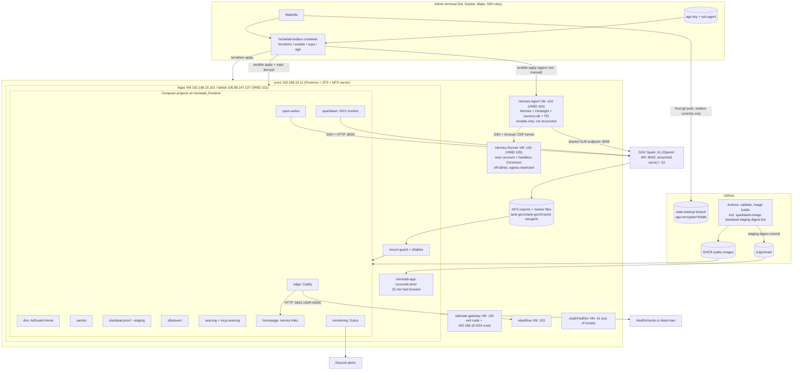
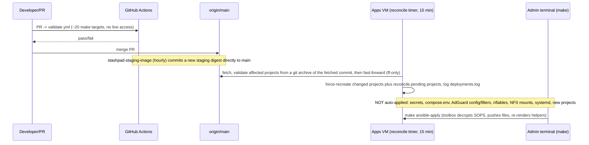
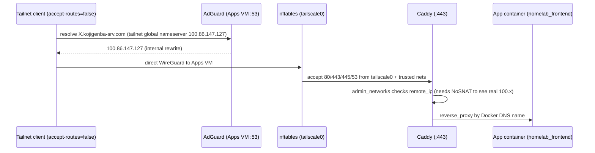

# Codebase Map

> Originally generated by Cartographer; incrementally maintained. Last mapped: 2026-10-16T12:55:43Z
> Source: full-map baseline 2026-10-10, incremental updates through 2026-10-12, then full re-verification on 2026-10-16: every tracked file was re-read in four slices (entry points/CI/scripts, Ansible/Compose, Terraform/network/storage, docs), and file/token counts were remeasured. Statements marked *(inferred)* were not verified against a live system. This map describes the repo; live observations cite dated operator checks.

## 0. Read this first (rules for agents)

- **The repo is infrastructure-as-code for a single-node homelab.** Production = **one Debian 13 "Apps VM" running 11 Docker Compose projects (12 services; counted from `files/services/compose/*/compose.yaml`)** on a Proxmox host (`pve1`). Kubernetes (Kubespray/Flux/MetalLB/cert-manager) was **fully retired on 2026-09-23**; `docs/archive/` holds frozen history; `k8s-volumes` is still an active NFS data path.
- **Merging to `main` is a production deploy for Compose changes.** A systemd timer on the Apps VM fast-forwards `/opt/homelab` from `origin/main` every 15 min and force-recreates the changed projects. Treat any PR touching `files/services/compose/**` as a live change. **New projects need `make ansible-apply` to update the helpers**; new secrets are required only when the project uses them, and explicit startup is needed only if it remains stopped after apply (see §4.1).
- **Never run live operations without explicit user approval:** `make terraform-apply`, `make tailscale-apply`, `make ansible-apply`, `make rollback-app`, `make state-restore`, NFS/ZFS/IX2215 changes, `terraform destroy`. Read-only validation (`make` fixtures/lint/validate) is fine.
- **Do not read or print secrets.** `files/infrastructure/secrets/runtime.sops.yaml` is encrypted (leave it alone); plaintext `runtime.yaml`, `*.tfstate*`, `terraform.tfvars`, `acl-policy.live.json`, `tmp/`, `*.log` (`teraterm.log`, `ts.log` at repo root) are gitignored and may hold sensitive data.
- **Hard "never" list** (from docs): never delete the `state-backup` branch; never delete dataset `tank-gen2/data/k8s-volumes` or its in-use data: retirement preserved 3 app directories (SillyTavern and stashPad prod/staging); `group_vars/apps.yml` now declares a fourth use, Open WebUI; do not modify VMID 111 (`stashPadDev`, outside production recovery) or 9000 (shared clone template) unless the task explicitly concerns them; rebuilding either follows [Proxmox host recovery](operations/proxmox-host-recovery.md); keep ZFS snapshot `@pre-phase5-retire-20260923` until explicitly approved; never remove the `192.168.10.0/24` advertisement from the Tailscale gateway; never copy the age private key to the Apps VM; preserve adoption-time ADR decisions; later decisions/clarifications go in dated supplements or a new ADR, and replacing a premise requires a new ADR plus current design, runbook and index updates; never put the sparkDash token, SSH private key or NodeID in docs/commits.
- **Root [CLAUDE.md](../CLAUDE.md) and [AGENTS.md](../AGENTS.md) carry the same short pointer to this map and must be kept identical; no `CONTRIBUTING.md` exists.** Docs are mostly Japanese; identifiers/commands are English.

## 1. System Overview



## 2. Directory Structure

```
homelab/
├── README.md                     # Japanese top-level orientation + operating policy
├── Makefile                      # ONLY entry point: terraform/ansible/tailscale/state/secrets/rollback/fixtures
├── .gitignore                    # secrets/state/plans; k8s protection rules retained after cleanup
├── .github/
│   ├── dependabot.yml            # weekly: 12 docker-compose + 6 docker + 7 terraform + actions; monthly: grouped toolbox pip; upstream Apps ignored until tag+digest
│   └── workflows/
│       ├── validate.yml          # CI gate (PR + push main): ~20 make targets
│       ├── caddy-image.yml       # build/push ghcr.io/koji-genba/caddy-cloudflare
│       ├── toolbox-image.yml     # build/push ghcr.io/koji-genba/homelab-toolbox:1.0.1
│       ├── sparkdash-image.yml   # PR: no-push validate; main: build/push ghcr.io/koji-genba/sparkdash:2.31.0 (digest in job summary)
│       ├── hermes-agent-image.yml  # build/push ghcr.io/koji-genba/homelab-hermes-agent (Hermes base + Hindsight provider; digest in job summary)
│       ├── memory-db-image.yml     # build/push ghcr.io/koji-genba/homelab-memory-db (PostgreSQL 17 + pgvector + PGroonga)
│       ├── tei-reranker-onnx-image.yml # build/parity/publish TEI ORT reranker
│       └── stashpad-staging-image.yml  # hourly: bump staging digest, commit direct to main
├── docs/                         # (~126k tokens at the full-map baseline; Japanese except this map)
│   ├── README.md                 # entry point: current design, operations, decisions, history
│   ├── CODEBASE_MAP.md            # code navigation (this document)
│   ├── adr/                      # 0001-0009 + README (decision log)
│   ├── architecture/target-state.md  # current design + unmet goals
│   ├── network/target-zones.md    # current network specification
│   ├── operations/               # application-lifecycle, apps-vm-recovery, apps-vm-tailnet, dgx-storage,
│   │                             # hermes-agent, hermes-agent-backup, homepage, nfs-export, open-webui,
│   │                             # proxmox-host-recovery, searxng, sparkdash, tiered-storage, smb-performance-troubleshooting
│   └── archive/                  # README + frozen migration records, pre-migration audit/inventory,
│                                 # ix-acl-stateful-runbook, proxmox-rebuild
├── files/
│   ├── infrastructure/
│   │   ├── ansible/apps/         # site.yml + 8 roles + group_vars/inventory (+ *.example)
│   │   ├── ansible/gateway/      # registered gateway prefs: site.yml, group_vars/gateway.yml, ansible.cfg; tracked inventory/hosts.yml + example
│   │   ├── ansible/elastiflow/   # VM 103 native packages/config + commit/checksum-pinned dashboards; separate manual apply
│   │   ├── ansible/agent/        # Agent/Runner VM OS root: site.yml, inventories, group_vars/{all,agent,runner}, roles
│   │   │                         #   (common, docker, firewall, agent_storage, agent_stack, agent_ops, runner)
│   │   ├── terraform/            # apps-vm, tailscale, agent-vm, runner-vm, elastiflow, tailscale-gateway, stashpad-dev (CI-validated)
│   │   ├── network/              # README + config.txt (annotated IX2215 startup-config copy)
│   │   ├── storage/              # mover.sh + mover.logrotate (run on pve1, not in VM)
│   │   └── secrets/              # runtime.sops.yaml (encrypted), runtime.yaml.example, README, agent/ (agent bundle)
│   ├── services/
│   │   ├── compose/<project>/    # 11 projects: edge dns samba stashpad-prod stashpad-staging sillytavern open-webui searxng sparkdash homepage monitoring (+ .env.example, README)
│   │   ├── agent/                # Hermes stack, OUTSIDE the Apps reconcile scan path: stack/compose.yaml (project `agent`) + hermes/skills/
│   │   └── images/               # caddy-cloudflare/Dockerfile, sparkdash/Dockerfile, hermes-agent/Dockerfile, memory-db/Dockerfile, tei-reranker-onnx/Dockerfile (custom images, built by CI)
│   └── tools/homelab-toolbox/    # Dockerfile, entrypoint.sh, README, requirements.txt, regenerate-requirements.py (pinned management toolbox)
└── scripts/                      # sh helpers (state backup/restore, validation) + scripts/tests/*-fixture.sh
```

Present on disk but untracked/ignored (do not read): `teraterm.log`, `ts.log`, `tmp/` (device config backups), `files/infrastructure/terraform/*/terraform.tfstate*`, `terraform.tfvars`, `acl-policy.live.json`, `files/infrastructure/secrets/runtime.yaml` if present.

## 3. Module Guide

Module token estimates were measured on 2026-10-16 with the Cartographer scanner (`cl100k`).

### 3.1 Makefile + toolbox (`Makefile`, `files/tools/homelab-toolbox/`) — ~3.7k + ~3.8k tokens

**Purpose**: single entry point. Almost every target runs in the digest-pinned toolbox: `docker run --rm --network host --user $(id -u) -v $(CURDIR):/workspace …`.
**Env passed by name only** (values never echoed): `TF_VAR_proxmox_api_token`, `TF_VAR_ssh_public_key`, `TAILSCALE_OAUTH_CLIENT_ID/SECRET`, `TAILSCALE_API_KEY`; `SSH_AUTH_SOCK` (mounted as `/run/ssh-agent`), `AGE_IDENTITY_FILE` (mounted ro at `/run/secrets/age-identity`), `AGE_RECIPIENT`, `~/.ssh/known_hosts` (ro).
**Toolbox contents**: terraform 1.15.4, sops 3.10.2, age 1.2.1, ansible-core 2.19.2, ansible-lint 25.8.2, shellcheck, AdGuardHome 0.107.79 (as `adguardhome-check`), python3+jinja2+yaml, nss_wrapper (arbitrary-UID ssh).
**Pinning**: `TOOLBOX_IMAGE` = `repo@sha256:…` (tag `1.0.1` is mutable and was re-pushed once). After `toolbox-image.yml` publishes, bump `TOOLBOX_IMAGE_DIGEST` by hand (`docker buildx imagetools inspect`).

| Group | Targets |
|---|---|
| Toolbox | `toolbox-build` (also the default goal; tags `:1.0.1` locally, not the digest), `toolbox-requirements` (regenerates Python wheel pins/hashes with `TOOLBOX_IMAGE`; only the toolbox directory is mounted, no credentials) |
| Terraform apps-vm | `terraform-init`, `terraform-fmt`, `terraform-validate`, `terraform-plan`, `terraform-apply`; `TERRAFORM_PLAN_ARGS` appends optional plan arguments (empty by default) |
| Tailscale (manual, import-first) | `terraform-validate-tailscale`, `tailscale-init`, `tailscale-acl-encrypt`, `tailscale-acl-decrypt`, `tailscale-acl-preflight`, `tailscale-plan`, `tailscale-apply`, `tailscale-import-core`, `tailscale-import-acl`, `tailscale-import-dns`, `tailscale-import-router` |
| Ansible | `ansible-lint`, `ansible-check`, `ansible-apply` |
| Ansible, gateway prefs root | `ansible-lint-gateway`, `ansible-check-gateway` (CI); `ansible-apply-gateway` (manual; `GATEWAY_ANSIBLE_ARGS=--check` previews live state) |
| Ansible, Hermes Agent/Runner root | `ansible-lint-agent`, `ansible-check-agent` (CI); `ansible-apply-agent` (manual, live VMs) |
| Terraform agent-vm / runner-vm | `terraform-validate-agent-vm`, `terraform-validate-runner-vm` (CI, `-backend=false`); per-root `terraform-plan` / `terraform-apply` via `TERRAFORM_ROOT` |
| Terraform ElastiFlow / gateway / stashPadDev | `terraform-validate-elastiflow`, `terraform-validate-tailscale-gateway`, `terraform-validate-stashpad-dev` (CI, `-backend=false`); roots selected by `ELASTIFLOW_ROOT`, `TAILSCALE_GATEWAY_ROOT`, `STASHPAD_DEV_ROOT` |
| ElastiFlow Ansible | `ansible-lint-elastiflow`, `ansible-check-elastiflow` (CI syntax-check); manual `ansible-apply-elastiflow`, separate from Apps reconcile; `ELASTIFLOW_ANSIBLE_{ROOT,INVENTORY,CONFIG,ARGS}` |
| CI fixtures | `gateway-routes-test`, `ansible-bootstrap-paths-test`, `terraform-apps-vm-lifecycle-test`, `toolbox-uid-test`, `cloud-init-test`, `compose-config`, `adguard-config-check`, `gatus-config-check`, `compose-reconcile-fixture`, `mover-test`, `shellcheck`, `secrets-scan`, `state-backup-test`, `state-restore-test`, `state-backup-preflight-test`, `tailscale-acl-path-test`, `tailscale-import-gates-test`, `agent-compose-config`, `agent-vm-cloud-init-test`, `runner-vm-cloud-init-test`, `terraform-agent-runner-vm-lifecycle-test`, `runner-privilege-fixture`, `runner-firewall-fixture`, `agent-runner-scope-fixture`, `agent-dnat-guard-fixture`, `agent-backup-fixture`, `agent-healthcheck-fixture`, `agent-restore-fixture`, `agent-rebuild-fixture`（restore fixtureからmodel-fetch/ops-cleanup/ops-behaviorも実行） |
| Not in CI | `preflight` |
| Ops | `state-backup`, `state-backup-push` (alias), `state-backup-preflight`, `state-restore`, `rollback-app` |
| Secrets | `secrets-encrypt` (needs `AGE_RECIPIENT`, refuses to overwrite), `secrets-decrypt-check` (needs `AGE_IDENTITY_FILE`), `secrets-encrypt-agent` / `secrets-decrypt-check-agent` (the `secrets/agent/runtime.sops.yaml` bundle) |

`validate.yml` sets `TOOLBOX_BUILD_IMAGE` and `TOOLBOX_IMAGE` to the same local tag, `homelab-toolbox:ci`, so subsequent toolbox checks use the image built from that checkout. Normal Makefile execution still defaults to the published digest. `ansible-check` is syntax-check only; `preflight` statically checks `APPS_MANAGEMENT_IP`/`APPS_VMID` against the VLAN-10 convention, without checking that either is free.

**Apply gating**: `terraform-apply`/`tailscale-apply` apply only a saved plan (`terraform.tfplan`, must be mode 0600, non-symlink), run `state-backup-preflight` first and `state-backup` after (needs `AGE_RECIPIENT`, `AGE_IDENTITY_FILE`, `SSH_AUTH_SOCK`). There is **no `make destroy`**.
**Host extras**: some targets run on the host and need `python3`+PyYAML (`ansible-bootstrap-paths-test`, `cloud-init-test`, `terraform-apps-vm-lifecycle-test`, `compose-reconcile-fixture`), `docker compose` (`compose-config`), bash + rsync + coreutils/findutils + flock (`mover-test`, host-run with mountpoint/ZFS stubs). See [toolbox dependencies](../files/tools/homelab-toolbox/README.md).

### 3.2 Ansible (`files/infrastructure/ansible/apps/`) — ~23.5k tokens

**Entry**: `site.yml` (hosts `apps`, `become`), inventory `inventory/hosts.yml` (Git-tracked non-secret config; `ansible_host` = Apps VM, user `deploy`, SSH-agent auth), vars `group_vars/apps.yml` (Git-tracked non-secret desired state; `.example` siblings use the current management IP while retaining illustrative inputs).
**Pre-tasks**: assert coupled cutover flags (`application_cutover_confirmed`, `network_migration_complete`, `legacy_service_addresses_enabled`, `legacy_service_cutover_confirmed`; with `network_migration_complete=true` both legacy flags must be false); tailnet IP validation; resume interrupted DNS rollout; stop `homelab-apps.service` if cutover not confirmed (never remount NFS under a writer).
**Role order**: `base` → `docker` → `storage` → `network` → `tailscale` → `firewall` → `secrets` (only when `application_cutover_confirmed`) → `compose`.

| Role | Configures |
|---|---|
| `base` | hostname, apt packages, `deploy` user, SSH hardening (pubkey only, `AllowUsers deploy`), sudoers, `/etc/homelab`, `/opt/homelab`, `/var/lib/homelab`, journald (500M/14d) |
| `docker` | Docker apt repo (deb822), engine+compose plugin, `daemon.json` (`json-file`; rotation options are defined in [`daemon.json.j2`](../files/infrastructure/ansible/apps/roles/docker/templates/daemon.json.j2); see the [ADR-0004 supplement](adr/0004-dns-and-minimal-observability.md) for the 2026-10-12 decision) |
| `storage` | NFS writeback sysctl; 9 NFSv4.1 mounts from `192.168.10.11` (all `nconnect=8`; `ro` until cutover, `stashpad-media` always ro); `homelab-mount-guard` script+unit (checks source, `nfs4`, mode, marker file+content) |
| `network` | IPv6 off; legacy VLAN-11 service-address helper (disabled, gate-asserted off); systemd-resolved split DNS (only `~kojigenba-srv.com` → local AdGuard) |
| `tailscale` | apt repo, `ip_nonlocal_bind=1`, asserts node is Running (**registration is manual**), `accept-routes=false accept-dns=false snat-subnet-routes=false`, pins tailnet IP |
| `firewall` | nftables `inet homelab_filter` (input drop-by-default; 22/53/80/443/445 from tailscale0 + trusted networks; UDP 41641; forward guard drops DNAT'd flows from untrusted sources) |
| `secrets` | controller-side `sops decrypt` (`no_log`), writes 0600 env files under `/etc/homelab/secrets/` and renders `/etc/homelab/adguard/AdGuardHome.yaml`; generates the SearXNG key at apply time with a controller-side `password` lookup, writing it only to the VM's `searxng.env` (`force: false` preserves it; not in SOPS). sparkDash: writes `sparkdash.env` (`SPARKDASH_TOKEN=`, root 0600; `sparkdash.token` is **required and validated as 64 hex characters only when `application_cutover_confirmed=true`**; pre-cutover bootstrap skips this role), always creates `sparkdash-ssh/` (10001:10001, 0500), writes `id_ed25519` (10001:10001, 0400) only when `sparkdash.ssh_private_key` is non-empty and **deletes it when omitted/empty** |
| `compose` | clones repo to `/opt/homelab` (**`update: false`**), renders `/etc/homelab/compose.env`, digest-pin gate on all 11 projects (explicit list in `roles/compose/tasks/main.yml`), creates external network `homelab_frontend`, installs helpers + systemd units/timers, force-recreates on secret/env change, DNS probes |

**Installed on the VM**: `/usr/local/sbin/{homelab-compose-up,homelab-compose-down,homelab-app-reconcile,homelab-rollback-app,homelab-healthchecks-ping,homelab-mount-guard,homelab-nft-reload,homelab-service-addresses}`; units `homelab-apps.service`, `homelab-app-reconcile.{service,timer}`, `homelab-healthchecks-ping.{service,timer}`, `homelab-mount-guard.service`.
**`homelab-compose-up all` order**: `edge dns samba stashpad-prod stashpad-staging sillytavern open-webui searxng sparkdash homepage monitoring` (down = exact reverse, `monitoring` first). Enforces `@sha256` on every image, `up -d --wait --wait-timeout 300` (300 comes from `group_vars/apps.yml`; template default is 120). **Project lists are hard-coded** in the Ansible-rendered helpers (`homelab-compose-up/-down`, `homelab-rollback-app`, `homelab-healthchecks-ping`, `homelab-app-reconcile`) and the digest gate — no directory scan — so a VM still on old helpers ignores/never starts a new project until `make ansible-apply` re-renders them.
**Reconcile** (`homelab-app-reconcile`): skips if `/var/lib/homelab/reconcile.paused`; refuses dirty checkout; maps changed paths → projects (`files/services/compose/<p>/*`; `.env.example` → all, including `homepage`; `images/caddy-cloudflare/*` → `edge`; `images/sparkdash/*` → `sparkdash`); validates from `git archive` of the new SHA; `merge --ff-only`; `HOMELAB_FORCE_RECREATE=true homelab-compose-up <p>`; logs to `/var/lib/homelab/deployments.log`; failures kept in `reconcile.pending`. **Never applies** infra, secrets, firewall, AdGuard config or `compose.env` — those need `make ansible-apply`.
**Dead-man ping** (every 60 s) only fires if mount guard, apps service, tailscaled+IP, rootfs %, clean checkout, Samba write probe, Caddy probe, and every active service in each listed project pass. Each service needs at least one running container and no unhealthy running containers; starting and running without a healthcheck are accepted, and stopped containers alongside running ones are ignored.

**Hermes Agent/Runner OS root (`files/infrastructure/ansible/agent/`)**: a separate playbook with hosts `agent` (VM 104) and `runner` (VM 105), inventory `inventory/hosts.yml` (user `deploy`), shared vars `group_vars/{all,agent,runner}.yml`, and `ansible.cfg` setting `roles_path = roles:../apps/roles` so the generic `docker` role is reused from the Apps root. **Applied by hand** (`make ansible-apply-agent`), never by CI. Agent role order: `common` → `docker` → `firewall` → `agent_storage` → `agent_stack` → `agent_ops`; the Runner play runs after and adopts the Runner/CDP SSH public keys the Agent play generated (`agent_runner_ssh_public_key`, `agent_cdp_tunnel_ssh_public_key`) via `hostvars`. `agent_stack` (WS2) owns the Compose project, Hermes config and Hindsight wiring; `agent_ops` (WS5) owns backup/restore/export/rebuild and the five-minute health check (see [the runbook](operations/hermes-agent-backup.md)). The Runner host enforces `firewall_egress_restrict` (internet only). The Agent host has no published ports.

**Gateway prefs root (`files/infrastructure/ansible/gateway/`)**: `site.yml` targets `gateway` (VM 102) with `become`, without gathering facts. `ansible.cfg` follows the Apps SSH conventions; `inventory/hosts.yml` and `inventory/hosts.yml.example` are both Git-managed, using cloud-init's `ubuntu` user, SSH-agent auth and `/usr/bin/python3` (Ubuntu 24.04 cloud-init template prerequisite; live presence unverified). `group_vars/gateway.yml` declares exit-node advertisement plus only `192.168.10.0/24`. Registration remains manual: read-only `tailscale status --json` must report Running before any mutation. `tailscale debug prefs` reads AdvertiseRoutes, compares sorted lists including both exit defaults, and `tailscale set` runs only on drift. Check mode reads status/prefs and reports a pending change without applying it. No login/logout/up or sysctl management: gateway cloud-init already declares IPv4/IPv6 forwarding. `GATEWAY_ANSIBLE_ROOT` / `GATEWAY_ANSIBLE_INVENTORY` / `GATEWAY_ANSIBLE_CONFIG` select the root, inventory and config, following the Agent convention. Dedicated `make ansible-lint-gateway` / `ansible-check-gateway` run in their own CI step; `make ansible-apply-gateway` is manual, outside CI/reconcile. Live application and rebuild steps are unverified; see the [gateway README](../files/infrastructure/terraform/tailscale-gateway/README.md).

### 3.3 Terraform (`files/infrastructure/terraform/`) — ~26.8k tokens

State uses the **default local backend per root** (`terraform.tfstate`, gitignored, mode 0600): local state locking applies; there is no shared remote backend. Recovery copy: `make state-backup` age-encrypts every `*.tfstate` to branch `state-backup`.

| Root | Provider | Provisions | Notes |
|---|---|---|---|
| `apps-vm` | bpg/proxmox 0.117.0 | Apps VM (VMID 101, 4c/12G/40G, `192.168.10.101`, VLAN 10) from pinned Debian trixie cloud image + cloud-init snippet | `ignore_changes=[initialization[0].user_data_file_id]` (guarded by a CI fixture); optional VLAN-11 NIC `legacy_service_nic=false`; needs ssh-agent for root@pve ops |
| `tailscale` | tailscale 0.29.2 | tailnet ACL + DNS (AdGuard nameserver `100.86.147.127`, `use_with_exit_node`) + optional subnet-router | gated by `manage_tailnet`, `enable_adguard_dns`, `adguard_ready`, `acl_policy_file`; ACL/DNS are imported, router is not; DNS has `prevent_destroy` |
| `tailscale-gateway` | bpg/proxmox 0.117.0 | VM 102, `192.168.10.102`, template-clone (VMID 9000) | registration manual; prefs via dedicated gateway Ansible (live unverified); approval via Terraform opt-in or admin console |
| `agent-vm` | bpg/proxmox | Hermes Agent VM (VMID 104, initial 12 vCPU / 24 GiB / 40 GiB OS + 100 GiB data disk, `192.168.10.104`, VLAN 10; 2026-10-17 WS14 user decision) from its own pinned Debian 13 cloud image | not on the tailnet; `ignore_changes=[initialization[0].user_data_file_id]`; Proxmox user/role/ACL manual; Ansible-only runtime |
| `runner-vm` | bpg/proxmox | Hermes Runner VM (VMID 105, 8 vCPU / 16 GiB / 40 GiB OS + 150 GiB work disk, `192.168.10.105`, VLAN 10) | separate cloud image `file_name`; no Docker, no Discord token/memory DB/management keys |
| `elastiflow` | bpg/proxmox 0.117.0 | VM 103, `192.168.10.103`; dedicated Ansible root pins unauthenticated ES/Kibana 8.19.22 + flowcoll 7.26.2 and imports pinned CODEX dashboards (empty-VM run unverified) | sFlow collector `:6343`; UI `https://elastiflow.kojigenba-srv.com` via Apps Caddy (trusted-only), LAN fallback `http://192.168.10.103:5601` |
| `stashpad-dev` | bpg/proxmox 0.117.0 | VM 111 `.41` (out of scope) | Gitignored per-root state/tfvars |

`apps-vm`: `snippet_datastore_id` must support both `Import` (cloud image) and snippets; keep `debian_cloud_image_url` and its SHA-512 checksum in sync.

Older roots (`elastiflow`, `tailscale-gateway`, `stashpad-dev`) full-clone `template_vm_id` (default 9000) and ignore changes to the cloud-init snippet reference, clone VMID and tags. Raw `terraform apply` does not back up state, so run `make state-backup` afterwards. The stashpad-dev README uses its own non-secret tfvars and saved-plan Make entry points (including state backup). As of 2026-10-25, its [development rebuild procedure](../files/infrastructure/terraform/stashpad-dev/README.md#開発環境の再構築) declares tools, a baseline `~/stashPad` checkout of `origin/main` and optional worktrees, separating observed versions from rebuild targets. The procedure has not been verified end to end on a VM; as of 2026-10-25, [`create-proxmox-ubuntu-template.sh`](../scripts/create-proxmox-ubuntu-template.sh) pins template creation to release-20260518 with a fixed URL and SHA-256, reproducing the observed settings except net0: VLAN 10 was selected on 2026-10-25 after untagged-template cloning failed with SDN.Use HTTP 403. Creation and cloning with this change on pve1 remain unverified; see the [recovery procedure](operations/proxmox-host-recovery.md#template-vm-9000).

2026-10-25 ACL recovery decision: the reviewed full policy is stored at `files/infrastructure/secrets/tailscale/acl-policy.sops.json` as a binary SOPS copy using the existing age key. See the [update/restore procedure](../files/infrastructure/terraform/tailscale/README.md#acl全文の復旧用コピー2026-10-25) for `tailscale-acl-encrypt` / `tailscale-acl-decrypt`.

`tailscale`: the ACL resource applies the whole reviewed live-export JSON rather than generating a policy; a precondition requires `autoApprovers.routes` keys to be within `advertised_routes`. Router management is opt-in (`manage_subnet_router=true`), targets tailnet hostname `home-gateway` (VM name `tailscale-gateway`), and must stay enabled on every plan after router import; see the [Terraform root README's import-helper gate constraints](../files/infrastructure/terraform/tailscale/README.md#import-helperのgate制約) for details. Import helpers explicitly forward all gates to their internal plan and reject missing gates for existing state before the first import, using `terraform state list` in the same toolbox/root with the default local backend and default workspace, without provider credentials. Missing `terraform.tfstate` is treated as an initial empty state; `terraform.tfstate.d` is rejected.

See [rebuildability and backup policy](architecture/target-state.md#再構築性とbackupの方針) for the VM assessment: the operator decided on 2026-10-12 that no VM will be backed up. For ElastiFlow and stashPadDev, this reflects acceptance of their loss, rather than repo rebuildability; the linked policy records the reasons and handling of their data. Remaining rebuild gaps are tracked in [#87](https://github.com/koji-genba/homelab/issues/87). The policy assumes the required recovery material and NFS data are available; protection of data on pve1's ZFS pools is a separate concern.

All seven roots are fmt/validated in CI. The three added Proxmox validate targets use `init -backend=false -input=false` and need no secrets or live API access. Generic `terraform-validate` retains its `terraform-init` prerequisite; plan/apply prerequisites are unchanged. The agent/runner roots also use `-backend=false` (no remote state access). All six Proxmox roots pin bpg/proxmox to `0.117.0` and are tracked by Dependabot separately, with provider bumps reviewed together.

### 3.4 Compose stacks (`files/services/compose/`) — ~13.9k tokens including configs; `files/services/images/` — ~1.5k tokens

Conventions: project name `homelab-<dir>`; all join external network `homelab_frontend`; **no `restart:` policy by design** (containers are started only through `homelab-compose-up`, invoked by `homelab-apps.service`, reconcile and Ansible); **every image is a literal `@sha256:` digest**; `no-new-privileges` on most projects (**not** set in `stashpad-prod` / `stashpad-staging`); the `searxng` service, sparkDash and Homepage declare `cap_drop: ALL`, `read_only`, tmpfs `/tmp` and explicit non-root users (`edge` has `read_only` + tmpfs); published ports bind to `${*_BIND_IP}` and `${APPS_TAILNET_IP}`. Config env: `/etc/homelab/compose.env` (documented in `.env.example`). `mcp-searxng` declares `cap_drop: ALL`, `read_only` and `no-new-privileges`, with no explicit user or tmpfs.

| Project | Services / image | Ports | Data | Notes |
|---|---|---|---|---|
| `edge` | Caddy (custom `caddy-cloudflare`) | 80, 443 (TCP only) | named volumes | `Caddyfile`; ACME DNS-01 via Cloudflare; `(admin_networks)` snippet restricts by `remote_ip {$CADDY_TRUSTED_NETWORKS}`; alias `dns.kojigenba-srv.com` for Gatus TLS probe; first external-VM upstream: ElastiFlow `192.168.10.103:5601` |
| `dns` | AdGuard Home | 53 tcp/udp | `adguard-work`, `/etc/homelab/adguard` | UI :3000 only via Caddy; config rendered by Ansible (outside the Git checkout) |
| `samba` | Samba (own image) | 445 | NFS: shared, shared-hdd, archive, ai; local `samba-state` (`/var/lib/samba`), `samba-logs` (`/var/log/samba`) | `config/smb.conf`, `config/users.json`, password from secrets dir; healthcheck overridden |
| `stashpad-prod` / `-staging` | stashPad (same image repo) | internal 8080 | NFS data + media (ro) | staging digest auto-bumped hourly from `:edge`; prod promoted by explicit PR |
| `sillytavern` | SillyTavern | internal 8000 | NFS data | basic auth from `sillytavern.env` |
| `open-webui` | Open WebUI v0.11.4 | internal 8080 | NFS `…/k8s-volumes/open-webui` | → vLLM at `192.168.10.51:8000/v1`; SQLite WAL **off** (NFS); `WEBUI_SECRET_KEY_FILE` keeps the session-signing key in the NFS data directory so recreation preserves logins |
| `searxng` | SearXNG + `mcp-searxng` v2.5.1 | internal 8080 / 3000 | cache volume only | `settings.yml` (json format on, limiter off, extra engines bing/yahoo/ddg web); `SEARXNG_SECRET` generated once at apply time by Ansible's controller-side `password` lookup, written only to VM `searxng.env` (`force: false`; not in SOPS) |
| `sparkdash` | sparkDash 2.31.0 (unofficial rebuild of upstream MiaAI-Lab/sparkDash, Apache-2.0; image `ghcr.io/koji-genba/sparkdash` by literal `@sha256`, built from `files/services/images/sparkdash/Dockerfile`) | internal 5555 (no host port, only `homelab_frontend`) | local named volume `sparkdash-config` at `/app/config` (**not NFS, no automated backup**) | "remote-only" DGX monitor: SSH + HTTP :8000 to DGX `.51` (head) / `.52` (worker), 2 units registered 2026-10-11; user 10001:10001, `read_only`, `cap_drop: ALL`, `no-new-privileges`, tmpfs `/tmp`; `SPARKDASH_ALLOW_OPEN_REMOTE=0` (refuses to start without `SPARKDASH_TOKEN`); healthcheck = authenticated `GET /api/health` (Bearer, 30 s, start_period 30 s); `sparkdash.env` + read-only bind of `sparkdash-ssh/` from `/etc/homelab/secrets/` |
| `homepage` | Homepage (official `ghcr.io/gethomepage/homepage`, literal digest in `homepage/compose.yaml`) | internal 3000 (no host port or Docker socket) | Git config only; tmpfs `/tmp` + `/app/config` | UID/GID 1000:1000; 6 read-only config binds in `compose.yaml`; no new secret or NFS mount |
| `monitoring` | Gatus | internal 8080 | named volume `gatus` at `/data` (SQLite `/data/data.db`; **not backed up by decision** — loss = history/alert state only) — no longer stateless | `monitoring/config.yaml`: 15 endpoints, including Homepage (`Host` header required) and sparkDash (`GET /` expects 200; no token, does not check DGX reachability); Discord alerts; behind Caddy basic auth |

`mcp-searxng` uses stateless Streamable HTTP and trusts one proxy hop (`MCP_HTTP_TRUST_PROXY=1`); keep `MCP_HTTP_ALLOW_PRIVATE_URLS` unset so `web_url_read` keeps rejecting private/loopback/tailnet targets.

**Hermes Agent stack (`files/services/agent/`)** is deliberately **outside** `files/services/compose/`: project `agent`, services `memory-db`, `embedding`, `reranker`, `hindsight`, `hermes` plus a `cdp-tunnel` sidecar, using digest references (all three self-built images published and pinned 2026-10-18), on a private bridge with no published port and **`restart: unless-stopped`** (no reconciler, state on the VM's data disk). `scripts/agent-compose-config.sh` (`make agent-compose-config`) renders it with synthetic env/secret files and re-checks the digest pins. Custom images `homelab-hermes-agent` (Hermes base + vendored Hindsight provider + `patches/0001-remote-media-session-key.patch` for post-handler remote MEDIA delivery; remove once fixed upstream), `homelab-memory-db` (PostgreSQL 17 + pgvector + PGroonga), and `homelab-tei-reranker-onnx` (FP32 tanh GELU ONNX on TEI cpu-1.9.4 ORT) are built by `hermes-agent-image.yml` / `memory-db-image.yml` / `tei-reranker-onnx-image.yml`; their published digests are pinned in the compose file. The stack is rendered and started by the `agent_stack` role. Bind-mounted Hermes config/SSH input changes (and missing persona/skill seeds) notify a scoped `--force-recreate --no-deps --wait` handler for `hermes` + `cdp-tunnel` (shared network namespace), after the normal Compose reconciliation handler; dependencies stay running. Main image input and auxiliary vision use the same DGX GLM endpoint; TTS/STT/image generation and external extraction are disabled, and `SEARXNG_URL` reaches Apps Caddy over HTTPS via `extra_hosts`. See [Hermes Agent operations](operations/hermes-agent.md).

**ElastiFlow UI**: [ADR-0009](adr/0009-elastiflow-caddy-fqdn.md) adds an exception to ADR-0007: `elastiflow.kojigenba-srv.com` resolves to `web_ip` and proxies via Apps Caddy to the LAN VM. Kibana has no authentication; `admin_networks` is its only Caddy access guard. Other LAN management UIs retain the gateway path. Caddy/Homepage changes reconcile from main; DNS requires manual `make ansible-apply` (all projects recreated on rendered runtime changes). Rolled out on 2026-10-22 (PR #116): DNS, HTTPS, the UI and the denied-source 403 were confirmed; shared links and `server.publicBaseUrl` remain unchecked. See the [runbook](../files/infrastructure/terraform/elastiflow/README.md#fqdn変更の反映と確認).

**Caddy routes** (all `*.kojigenba-srv.com`): `dns.` (trusted-only), `elastiflow.` (`import admin_networks` → `192.168.10.103:5601`, HTTP; trusted-only), `prod.`/`prod.stashpad.`, `staging.`/`staging.stashpad.` (open), `status.` (trusted + basic auth), `homepage.` (trusted + the same Gatus basic auth credentials), `sillytavern.`, `openwebui.` (open), `searxng.` and `mcp-searxng.` (trusted-only), `sparkdash.` (`import admin_networks` → `sparkdash:5555`; trusted-only, **deliberately no Caddy `basic_auth`** so the app's own `Authorization: Bearer` header passes).

**Homepage config** (`files/services/compose/homepage/config/`): `settings.yaml` defines layout/display and Quick Launch; `services.yaml` defines the 6 groups (matched by `settings.yaml`), links, `siteMonitor` targets and Gatus widget; `widgets.yaml` defines resources, date/time and SearXNG search; `bookmarks.yaml` is an empty list. `custom.css` styles copy cards and `custom.js` implements copying SMB/NFS/SSH destinations and adds those cards to search results. See [Homepage operations](operations/homepage.md).

### 3.5 Secrets (`files/infrastructure/secrets/`)

`runtime.yaml` (plaintext, gitignored) → `make secrets-encrypt` → `runtime.sops.yaml` (age, committed) → `make ansible-apply` decrypts on the **admin terminal** → 0600 files on the VM. Required keys: `cloudflare.api_token`, `adguard.{username,password_hash}`, `gatus.{discord_webhook_url,basic_auth_hash}`, `samba.koji-genba-password`, `sillytavern.{username,password}`, `healthchecks.ping_url`, `sparkdash.token` (required and validated as 64 hex characters only when `application_cutover_confirmed=true`; pre-cutover bootstrap skips the secrets role), `sparkdash.ssh_private_key` (optional; the VM-side key file is deleted when it is omitted/empty). Placement: `/etc/homelab/secrets/sparkdash.env` (`SPARKDASH_TOKEN=`, root:root 0600); `/etc/homelab/secrets/sparkdash-ssh/` always created (10001:10001, 0500; bind-mounted read-only with `create_host_path: false`) holding `id_ed25519` (10001:10001, 0400) when a key is supplied. Any secret change flips `secrets_runtime_changed` → `homelab-compose-up all` with force-recreate (all projects, incl. DNS and Samba). Edit the bundle for these keys with `sops set` inside the digest-pinned toolbox, then `chmod 0600` since `sops set` rewrites the file 0644 (not `make secrets-encrypt`: the Makefile and runbook say it refuses to overwrite an existing `runtime.sops.yaml`). `searxng.env` remains the only secret not in SOPS. All Proxmox credentials live in KeePassXC and enter only as `TF_VAR_proxmox_api_token`; Tailscale credentials remain environment inputs. All six Proxmox roots (`apps-vm`, `agent-vm`, `runner-vm`, `elastiflow`, `tailscale-gateway`, `stashpad-dev`) use the common token `terraform@pve!terraform` (`privsep=0`). Gitignored tfvars contain only non-secret inputs; Proxmox SSH uses ssh-agent. One age key protects both SOPS secrets and state backups (shared boundary).

**Agent bundle** (`files/infrastructure/secrets/agent/runtime.sops.yaml`, example `agent/runtime.yaml.example`): a second, separate SOPS/age bundle for the Agent VM. Keys: `discord.{bot_token,allowed_users,allowed_channels,free_response_channels,home_channel}` and `monitoring.{operator_webhook_url,deadman_ping_url}`. The PostgreSQL password and the Runner/CDP SSH keys are generated **on the Agent VM** (or on the controller) and are not in the bundle. Encrypt/check with `make secrets-encrypt-agent` / `make secrets-decrypt-check-agent`. The plaintext `agent/runtime.yaml` is gitignored and forbidden by `scripts/validate-secrets.sh`.

### 3.6 scripts/ — ~15k tokens

All POSIX `sh` + `set -eu` unless noted. `state-backup.sh` / `state-restore.sh` / `state-backup-preflight.sh` / `check-terraform-state-modes.sh` (age-encrypted state recovery; restore never overwrites, validates JSON, allow-lists paths); `check-saved-terraform-plan.sh`; `validate-tailscale-acl-path.sh` (ACL file must be in-repo, non-symlink); `validate-secrets.sh` (current tree only, not history; ignored files exempt unless tracked; rejects plaintext ACL exports and checks the binary SOPS ACL copy when present); `compose-config.sh` (offline `docker compose config` for every project with synthetic env); `adguard-config-check.sh` (when no binary is selected and the local image is unavailable, writes `skipped:` to stderr and exits 0 without pulling); `preflight-apps.sh` (VMID must equal last IP octet); `rollback-app.sh` (ssh wrapper, allow-list of 11 projects in its `case` statement, including `homepage`). `compose-config.sh` also creates a synthetic `sparkdash.env` (`SPARKDASH_TOKEN=fixture-only`) and an empty `sparkdash-ssh/` dir. `agent-compose-config.sh` renders the out-of-tree agent project with synthetic env/secret files and re-checks its digest pins (`make agent-compose-config`).

`state-backup.sh` removes ciphertexts for states absent from the local checkout, so back up only from a checkout holding every state you want kept. It keeps local-ahead commits, follows remote-ahead history and refuses divergent `state-backup` histories.

`scripts/tests/gateway-routes-fixture.sh` (`make gateway-routes-test`, CI) compares gateway Ansible effective advertised routes (subnets + exit defaults) with Terraform `tailscale/variables.tf` literal `advertised_routes` default, without credentials or APIs; optional file arguments allow synthetic mismatch tests. It does not inspect local tfvars or live state.

`scripts/tests/*-fixture.sh` — regression guards (string/structure asserts and fake-`age` tests); `adguard-config-fixture.sh` renders the real AdGuard template and its `service_names` list must include every internal FQDN (including `homepage`); `gatus-config-fixture.sh` also asserts Gatus `storage` is sqlite at `/data/data.db` and the exact line `      - gatus:/data` (`grep -Fx`, indentation-sensitive). The agent fixtures (`agent-backup`, `agent-healthcheck`, `agent-restore`, `agent-dnat-guard`, `agent-runner-scope`, `agent-vm-cloud-init`, `runner-vm-cloud-init`, `runner-privilege`, `runner-firewall`, `terraform-agent-runner-vm-lifecycle`) check the committed role/templates/scripts statically and never touch the VMs.

### 3.7 Network & storage (manual, device/host-side)

- `files/infrastructure/network/config.txt` + README: annotated copy of the NEC **IX2215** router config (zones, ACLs, DHCP, sFlow). Update **only after** the device is changed and `write memory`'d; compare by line set, not order. Not applied by any automation.
- Host OS, NIC, pool layout and Proxmox storage: see the [pve1 recovery runbook](operations/proxmox-host-recovery.md) for values confirmed on 2026-10-12 and items still unconfirmed.
- `files/infrastructure/storage/mover.sh`: runs on **pve1** (cron 05:00): rsync SSD cache (`/mnt/cache-sata`) → `/mnt/tank-gen2/data/shared`, verify, delete source, then ZFS snapshot (14 daily/8 weekly/12 monthly). `mover.logrotate`.
- Zones: VLAN 10 Server `192.168.10.0/24`, 20 Trusted, 30 IoT, 40 Guest (VLAN 11 and 63 abolished). Key hosts: router `.1`, pve1 `.11`, Apps VM `.101`, gateway `.102`, ElastiFlow `.103`, Hermes Agent VM `.104`, Hermes Runner VM `.105`, stashPadDev `.41`, DGX Sparks `.51`/`.52`. The Agent/Runner VMs are off-tailnet; operators reach them through the gateway subnet route.
- IX2215 policy: Trusted may initiate to Server and IoT, with replies via dynamic filters; unsolicited reverse and Guest inter-zone traffic are blocked. Port 8 is the AP's tagged four-VLAN trunk; keep its untagged base interface out of bridge groups (the network README records an ARP failure when it shared Guest's bridge).

## 4. Data Flow

### 4.1 Deploy: how a change reaches production



Caddy, toolbox and sparkDash images publish on main pushes touching their image directory or workflow, or via `workflow_dispatch`; only sparkDash has a PR image-build check. The stashPad staging digest updater runs on a schedule and supports manual dispatch.

Rollout order for **adding a Compose project** is documented in [application lifecycle](operations/application-lifecycle.md#新しいcompose-projectの追加): create the NFS directory/marker first **if NFS is used**, merge, wait for reconcile to advance the checkout, then run `make ansible-apply` to install updated helper lists. Wrong order can block startup/recreation of **all** projects (including reconcile recreations): `homelab-compose-up` checks every mount through the guard before touching any project; it can also fail the digest gate with `missing Compose project`.

Add SOPS keys before apply **only if the project needs new secrets** (sparkDash requires `sparkdash.token`; Homepage reuses Gatus auth). If `compose_runtime_changed` is true, apply force-recreates all projects; otherwise updating helpers alone does not start a new project in an already-active `homelab-apps.service`. Check startup after apply and use `homelab-compose-up <project>` if it remains stopped. This conditional procedure is derived from the implementation and has not been verified on live hosts. The dated [Homepage rollout record](operations/homepage.md#手動反映の記録) reports that explicit startup was unnecessary; the [sparkDash runbook](operations/sparkdash.md) records its own rollout and notification checks.

**The Hermes Agent stack is a separate, manual path.** It lives outside `files/services/compose/`, so the reconcile timer, digest gate, mount guard and `compose-config.sh` never see it. VM 104/105 are created by the `agent-vm`/`runner-vm` Terraform roots; the OS and Compose project are applied by hand with `make ansible-apply-agent` (Agent play first, so the generated Runner SSH keys exist as facts before the Runner play). The self-built images `homelab-hermes-agent`, `homelab-memory-db` and `homelab-tei-reranker-onnx` are published by their image workflows and pinned by digest in `files/services/agent/stack/compose.yaml` (all three first published 2026-10-18); the start helper still refuses to run on an ALL-ZERO placeholder or an unpinned image as a safety net. VMs 104/105 were created by Terraform and the pve1 backup export was prepared on 2026-10-18; Ansible has not yet been applied; see [Hermes Agent operations](operations/hermes-agent.md) and [its backup runbook](operations/hermes-agent-backup.md).

### 4.2 Request path (tailnet client → app)



LAN-only devices get public DNS (1.1.1.1/8.8.8.8) from DHCP, so they do **not** resolve internal names (this also applies to `sparkdash.`, whose rewrite points at the tailnet `web_ip`). The official SMB path is `\\samba.kojigenba-srv.com\<share>` (Apps VM tailnet address, including from home desktops); `\\192.168.10.101\<share>` deliberately selects LAN access (see [SMB performance troubleshooting](operations/smb-performance-troubleshooting.md)). The `sparkdash.` vhost is `admin_networks`-only and the app does its own Bearer-token auth (no Caddy basic auth in front).

### 4.3 Secrets & state

With cutover enabled, Ansible decrypts `runtime.sops.yaml` on the controller and writes VM runtime files: Caddy, Gatus, SillyTavern and sparkDash use root-owned 0600 env files under `/etc/homelab/secrets/` via `env_file` (`format: raw`). Samba bind-mounts `/etc/homelab/secrets/samba` at `/run/samba-secrets`, AdGuard bind-mounts `/etc/homelab/adguard` at `/opt/adguardhome/conf`, and the host dead-man helper sources `/etc/homelab/secrets/healthchecks.env`.

sparkDash also bind-mounts `sparkdash-ssh/` read-only (key file only if supplied); any secret change force-recreates all projects.

Two state stores worth knowing about are **local named volumes on the Apps VM, not NFS** (besides the edge/dns/searxng volumes in §3.4): `sparkdash-config` (units, history, known_hosts; no automated backup, not in NFS/ZFS snapshots/mover/Terraform state-backup; recovery = redeploy + redeliver token/key from SOPS + re-register the 2 DGX units in the UI, ~5 min) and `gatus` (SQLite history/alert state; deliberately not backed up). Samba's local `samba-state` and `samba-logs` volumes are listed in §3.4; the recovery runbook records that the pinned image regenerates identity from Git config plus the runtime password, so recheck on image updates. No Proxmox backup jobs or VM backups existed in the 2026-10-12 pve1 check; see [named-volume recovery scope](operations/apps-vm-recovery.md#vm内named-volumeの復旧範囲). Terraform state → local file → `make state-backup` → age-encrypted → `state-backup` branch (pushed from the **host** via ssh-agent; toolbox only commits locally).

### 4.4 Storage

Almost all app state is NFS from pve1 (exceptions: local named volumes such as `sparkdash-config` and `gatus`, see §4.3; sparkDash adds no NFS mount, marker or nftables rule), mounted at `/srv/homelab/nfs/<name>` with per-path marker files (`.homelab-export*`) that the mount guard verifies; failure ⇒ no containers start (fail-closed). `/mnt/shared` is a mergerfs SSD tier (cache-pool) with the nightly mover. `tank-gen2/data/ai` is a plain dataset exported `/24` (the one export not narrowed to `/32`) for the DGX Sparks.

The mover handles only regular files older than `SETTLE_MINUTES` by ctime, requires both mounts, uses `flock`, preserves numeric ownership, and skips the snapshot if any transfer/ownership error was counted. Snapshots cover only `tank-gen2/data/shared` (monthly on the 1st, else weekly on Monday, else daily); files still on `cache-pool`, plus `ai`, `archive`, `k8s-volumes` and VM-local named volumes, are excluded, and same-dataset snapshots are not an independent backup (see [Tiered Storage](operations/tiered-storage.md)).

## 5. Conventions

- **Naming**: Compose project `homelab-<dir>`; VM paths `/opt/homelab`, `/etc/homelab/{compose.env,secrets,adguard}`, `/srv/homelab/nfs/<name>`, `/var/lib/homelab/`; Apps VM VMID = last IP octet on VLAN 10, enforced by `scripts/preflight-apps.sh` (not universal: stashPadDev is VMID 111 at `192.168.10.41`); FQDNs `*.kojigenba-srv.com`.
- **Secrets/examples**: Terraform `terraform.tfvars` is local and gitignored; Ansible `group_vars/apps.yml` and `inventory/hosts.yml` are Git-tracked non-secret settings. Their `*.example` siblings are tracked too; keep examples in sync.
- **Images**: digest-pinned everywhere; Dependabot weekly (`docker-compose` for Compose, `docker` for Dockerfiles). Apps upstream images are currently ignored (digest-only would follow `latest`) until a follow-up tag+digest migration; Apps self-built `koji-genba/*` and Agent self-built `koji-genba/homelab-*` are ignored permanently (Agent self-built digests are manually re-pinned by each workflow). Agent upstream CPU TEI and slim Hindsight are tag+digest and remain tracked. Reranker Python minor/major updates are ignored for cp312 wheels. See [update policy](architecture/target-state.md#ライフサイクルと更新). Staging auto-tracks, prod promoted by reviewed commit; no Watchtower, no CI direct deploy. **Custom images (caddy-cloudflare, sparkdash)**: CI builds/pushes to GHCR, prints the digest in the job summary, and a human pastes it into `compose.yaml` in a separate PR (CI never commits it). `sparkdash-image.yml` also has a no-push `validate` job on PRs and sets `packages:write` at job level; `caddy-image.yml` has no PR validate job and sets it at workflow level. Bumping sparkDash = Dockerfile `SPARKDASH_REVISION` (40-hex SHA) + version label + workflow tag together.
- **ADRs**: `docs/adr/NNNN-kebab-title.md`; preserve adoption-time decisions; record later decisions/clarifications in dated supplements or new ADRs. Replacing a premise requires a new ADR plus updates to the current design, runbooks and index (see [docs policy](README.md#文書の置き方) and [ADR index](adr/README.md)).
- **Operations docs**: fixed-order rollout steps (A/B/C), "手動反映の記録" tables for manual changes (date, operator, before/after, hash, commit). Each app gets its own runbook under `docs/operations/` that ends with a dated manual-rollout record (e.g. `sparkdash.md`, ~318 lines, sections 用途と構成 … 既知の制約 / 手動反映の記録). Do not record personal IDs/emails/NodeIDs. Record network exceptions in Git first (source, destination, port, purpose, retirement condition).
- **Git/PR flow**: feature branches (`docs/*`, `feat/*`, `fix/*`, `dependabot/*`) → PR → merge commits ("Merge pull request #N from koji-genba/<branch>"); commit subjects mix plain English and conventional prefixes (`feat(network): …`, `chore(staging): …`). `state-backup` is a data branch, not a code branch. Feature-branch applies before merging in `apps-vm-tailnet.md` describe the 2026-09-26 initial cutover; current rebuild/re-registration follows the [runbook's current procedure](operations/apps-vm-tailnet.md#現在の手順apps-vmを再構築再登録するとき) from main.
- **Tests/CI**: `validate.yml` runs on PRs and pushes to main: formatting, Terraform validate, Ansible lint/syntax, Compose config checks, shell lint, secret/state scans and regression fixtures; `sparkdash-image.yml` also builds matching PRs without publishing. Shell fixtures check template/script structure rather than live behavior; branch protection state is undecided in docs.

## 6. Gotchas

**Operational traps**
1. **Merge = deploy.** Compose changes on `main` hit prod within ~15 min; the staging bot even pushes straight to `main` (its commits probably don't trigger `validate.yml` since they use `GITHUB_TOKEN` *(inferred)*).
2. `make ansible-apply` needs `SSH_AUTH_SOCK` (else UNREACHABLE at Gathering Facts) **and** `AGE_IDENTITY_FILE` (else the secrets role fails opaquely due to `no_log`). It force-recreates all 11 projects (the `all` list in `homelab-compose-up.sh.j2`) when secrets/`compose.env` change (any sparkDash secret edit included, so DNS and Samba restart too). Re-creation on every apply is tracked as a known issue in [#35](https://github.com/koji-genba/homelab/issues/35).
3. Ansible does **not** update `/opt/homelab` (`git update: false`); only the reconcile timer does. AdGuard config + `dns/filters/*.txt` come from the **controller's working tree** at apply time.
4. Flipping `application_cutover_confirmed` changes NFS ro/rw mode, guard script and unit states together — re-run Ansible.
5. `nconnect` is fixed per (server, proto, version) by the first mount: all 9 mounts must use `nconnect=8`; changing it needs a VM reboot.
6. `homelab-compose-up` runs the guard before touching any project; it checks every mount, so one missing/incorrect marker blocks starting/recreating **all** projects (including reconcile recreations) and suppresses dead-man pings. It does not stop already-running containers; after reboot nothing starts; create markers on pve1 first, never in an unmounted VM dir.
7. Proxmox user/role/token/ACLs are **not in IaC**. `terraform destroy` removes the `/vms/<id>` ACL → next apply fails with HTTP 403. **Common API token `terraform@pve!terraform` expires 2027-10-31 23:59:59 JST** (`privsep=0`). All six Proxmox roots share it; the expected identity configuration was checked against pve1 on 2026-10-25. See the [migration record](operations/apps-vm-recovery.md#実機確認認証移行の実施記録2026-10-25) for details and [Proxmox preparation](operations/apps-vm-recovery.md#terraform実行前のproxmox側準備) for ACLs and token renewal.
8. Tailscale: always pass `MANAGE_TAILNET=true ENABLE_ADGUARD_DNS=true ADGUARD_READY=true` together (else `prevent_destroy` fails the plan); after router import also retain `MANAGE_SUBNET_ROUTER=true`. Import helpers forward all gates and reject missing gates for existing state before import; abort if a plan shows DNS config as "will be created". Apps VM tailnet registration and gateway `tailscale up` are manual; gateway advertisement prefs use `make ansible-apply-gateway`; disable key expiry on the Apps VM node.
9. IX2215 ACLs append-only: to edit an entry detach filter → `no ip access-list` → re-enter in order → re-attach; never remove `ip filter main-out 10 in` from BVI20; `reload` no longer rolls back saved changes. Use console, `enable-config`, `write memory` only after verification.
10. `make rollback-app` pauses auto-reconcile (`reconcile.paused`); resuming is manual. Rollback has no data/schema downgrade.
11. Adding a project/FQDN touches many places (see §7); the project list is baked into Ansible-rendered helpers and the digest gate (see 13).
12. Open WebUI: the first account created becomes admin; keep SQLite WAL off while on NFS; `OPENAI_API_BASE_URL` etc. are first-boot seeds only. SearXNG: upstream engine failures are not alerted by Gatus.
13. **New project lists require Ansible; secrets and explicit startup are conditional** (see §4.1). Applying before the checkout advances fails the digest gate with `missing Compose project`; a missing/invalid `sparkdash.token` fails the 64-hex assert only when `application_cutover_confirmed=true` (pre-cutover bootstrap skips the secrets role).
14. **sparkDash**: refuses to start without a token (`SPARKDASH_ALLOW_OPEN_REMOTE=0`; upstream default is open). Never `docker compose down -v` it — the named volume `sparkdash-config` holds units, history and known_hosts and has no backup.
15. **Gatus checks only `GET /` = 200** on sparkDash. The authenticated API is covered by the compose healthcheck, and DGX reachability only by looking at the UI.
16. **Accepted sparkDash limits**: `web_ip` is the tailnet IP, so LAN-only clients cannot resolve `sparkdash.`; `/` returns 200 unauthenticated; one shared token; SSH uses `accept-new` host keys (compare fingerprints out of band); fleet energy needs a compose restart after adding/removing units; keep Hermes monitoring disabled in the UI.
17. **`rollback-app.sh` restores only image + config** — not volumes, secrets or DGX-side changes; it cannot go back before the commit that added the project; and it leaves `reconcile.paused` set until someone releases it by hand (see 10).
18. **Gatus alert state is persisted since PR #78** (SQLite on named volume `gatus`; previously memory-only, so every recreate dropped the "resolved" notice). Reproduced/verified in Docker only; production confirmation after the next real restart is pending. `gatus-config-fixture.sh` guards the exact `      - gatus:/data` line, so re-indenting the compose file fails CI.
19. `reconcile.paused` stops automatic reconcile only; Ansible runtime recreation and `homelab-compose-up all` can still overwrite a rollback. A successful rollback queues a pending reapply, but a failed one may leave the pause without a pending retry; check both `reconcile.paused` and `reconcile.pending` before resuming (see [rollback and recovery](operations/application-lifecycle.md#rollbackと再開)).
20. **Agent VM operations (`agent_ops` role, [runbook](operations/hermes-agent-backup.md))**: the daily backup encrypts every artifact with the age recipients in `agent_backup_age_recipients` and **fails closed while that list is empty**, refuses to write unless `/mnt/agent-backups` is the NFS export (source+fstype+marker), and needs the pve1 export and marker created manually first. `homelab-agent-restore --scratch` needs a running production stack (shared stateless TEI over `agent_internal`) and Compose ≥ 2.24 (`!reset`/`!override`). Health check marks Hermes healthy only when `gateway_state.json` is `running` and every `platforms.*.state` is `connected`, so an unconfigured Discord shows as a failure. Pitfall when editing these role templates: a bash array-length `${#arr[@]}` contains `{#`, which Jinja reads as a comment start — wrap such lines in ``/`` (the teammate's render check catches it, `ansible-lint` does not).
21. **The Hermes Agent stack (`files/services/agent/`, [runbook](operations/hermes-agent.md)) is a separate, manual path, not reconciled.** memory-db PGDATA must stay 999:999 (0700); Ansible must preserve container-owned directories and mounted roots (2026-10-18 re-apply incident). Applied only with `make ansible-apply-agent`; it lives outside `files/services/compose/` and uses `restart: unless-stopped` (no reconciler). Its self-built images `homelab-hermes-agent`, `homelab-memory-db` and `homelab-tei-reranker-onnx` are published by their workflows and pinned by digest in `files/services/agent/stack/compose.yaml` (all three first published 2026-10-18); `homelab-agent-compose-up` still refuses to start on an ALL-ZERO placeholder or an unpinned image as a safety net. Both VMs are off-tailnet (LAN only; operators reach them via the gateway subnet route) and the Runner enforces internet-only egress. Hermes `config.yaml` and the Hindsight plugin config are Ansible-rendered and overwritten on apply; the bank policy is applied through the API and the weekly-review cron is registered when absent. The `SOUL.md`/shipped skill seeds preserve existing files (`force: false`). Edit managed configuration in the repo; the durable pieces are the memory/session data and the Runner work tree (see the [backup runbook](operations/hermes-agent-backup.md)). The embedding (`cl-nagoya/ruri-v3-310m`) is an asymmetric retriever using a task prefix, so changing it changes the vectors and requires re-embedding the bank (export, not backup).

**History and remaining code / operational issues**

- Current project/service definitions are listed in §3.4. ADR-0001's 7 projects record the adoption-time scope. Pre-migration baselines, migration/handoff records and the old IX/Proxmox runbooks are frozen under [archive](archive/README.md). Current Proxmox host recovery is covered by [the host runbook](operations/proxmox-host-recovery.md); [Apps VM recovery](operations/apps-vm-recovery.md) covers the VM alone.
- Remaining k8s/VLAN-11 code: `.gitignore` rules, `192.168.11.0/24` in `compose-config.sh` synthetic env and in `trusted_networks` (the nft template drops it post-migration), `legacy_ldaps_ip` in the AdGuard fixture, disabled legacy-address Ansible plumbing, Samba `netbios name = k8s-samba`. These differ from the active `k8s-volumes` data path; do not delete that data.
- The retired `k8s-cluster` local directory and encrypted recovery state were removed on 2026-10-12. VMIDs 101-103 belong to current VMs. See [state recovery and root retirement](operations/apps-vm-recovery.md#復旧フロー).
- The two remaining untracked Kubernetes secret files under `files/kubernetes/` on the admin terminal were deleted on 2026-10-12. The old k8s-specific `.gitignore` rules no longer have target files but were retained as protection, without modification.
- The retired VLAN 11 ACL `/sdn/zones/localnetwork/vmbr0/11` was deleted on pve1 on 2026-10-12 after `qm config` confirmed that each VM had only one NIC, on VLAN 10. `terraform@pve` had 6 ACL paths at that check; its comment was changed to `Terraform Apps VM (VMID 101)`. The current expanded path expectations and propagation values are documented in [Proxmox preparation](operations/apps-vm-recovery.md#terraform実行前のproxmox側準備).
- ElastiFlow ingestion was confirmed on the VM and [#34](https://github.com/koji-genba/homelab/issues/34) was closed on 2026-10-12. When and how it recovered is unconfirmed; see the [dated live check](../files/infrastructure/terraform/elastiflow/README.md#実機確認2026-10-12).
- `compose-config.sh` runs Docker Compose on every discovered definition and command failures are not ignored; discovery of zero definitions now fails. `adguard-config-check.sh` reports a skip and exits 0 when its local image is unavailable. Render checks are not comprehensive for systemd/Jinja templates; `mover-test` is now in CI. Dead-man checks require at least one running container per active service and reject unhealthy running containers; starting is accepted and stopped containers alongside running ones are ignored.
- **Router credential review:** credentials in the tracked `files/infrastructure/network/config.txt` were confirmed masked, with no real values, on 2026-10-12.

## 7. Navigation Guide

| To… | Touch |
|---|---|
| Add a Compose project | Worked examples: [Homepage](operations/homepage.md) (PRs #82-#84; no new secret/NFS), [sparkDash](operations/sparkdash.md) (PRs #75-#80; required secret), searxng/open-webui (PR #68, #63). Touch: `files/services/compose/<p>/compose.yaml` (digest-pinned, `homelab_frontend`, no restart); `files/services/images/<p>/Dockerfile` + `.github/workflows/<p>-image.yml` if it is a custom image; `edge/Caddyfile` site; `monitoring/config.yaml` endpoint; AdGuard `rewrites` in `roles/secrets/templates/AdGuardHome.yaml.j2` **and** `service_names` in `scripts/tests/adguard-config-fixture.sh`; if new secrets are needed: `roles/secrets/tasks/main.yml` + `runtime.yaml.example` + synthetic files in `scripts/compose-config.sh`; `nfs_mounts` + path var in `group_vars/apps.yml` (+ `.example`) and `compose.env.j2` if it uses NFS (marker on pve1 first); `roles/compose/tasks/main.yml` (digest gate) and the five templates with hard-coded lists (`homelab-compose-up` incl. its usage text, `homelab-compose-down`, `homelab-rollback-app`, `healthchecks-ping.sh.j2`, `homelab-app-reconcile.sh.j2`); `scripts/rollback-app.sh` allow-list; `.github/dependabot.yml` (compose + images entries); `files/services/compose/README.md`; `docs/operations/<p>.md` (runbook + rollout record); docs that state project counts (`README.md`, `docs/architecture/target-state.md`, `docs/operations/application-lifecycle.md`, `apps-vm-recovery.md`). Then follow the rollout order in §4.1 / gotcha 13. Grep an existing project name (e.g. `sparkdash`) across the repo to find every list. |
| Remove a Compose project | Follow [project removal](operations/application-lifecycle.md#projectの撤去共通手順): quiesce reconcile and stop the project while its definition still exists, then update helper lists before advancing the VM checkout. Ansible does not remove mounts deleted from `nfs_mounts`; client cleanup is explicit. |
| Bump the sparkDash image | `files/services/images/sparkdash/Dockerfile` (`SPARKDASH_REVISION` + version label) and the tag in `.github/workflows/sparkdash-image.yml` together → run the workflow (push to main on those paths, or `workflow_dispatch`), copy the digest from the job summary → **separate PR** pasting it into `files/services/compose/sparkdash/compose.yaml` → reconcile applies within 15 min |
| Change the Hermes Agent stack | VM 104/105: `files/infrastructure/terraform/{agent-vm,runner-vm}/`, OS + roles `files/infrastructure/ansible/agent/`, Compose `files/services/agent/stack/compose.yaml` (project `agent`), Hermes config/SOUL/Hindsight templates under `roles/agent_stack/`, backup/restore/health under `roles/agent_ops/`, secrets `files/infrastructure/secrets/agent/`. Apply by hand (`make ansible-apply-agent`); never reconciled. See [Hermes Agent operations](operations/hermes-agent.md). |
| Update a Hermes custom image | Edit `files/services/images/{hermes-agent,memory-db}/Dockerfile` → run `.github/workflows/{hermes-agent,memory-db}-image.yml` → copy the digest from the job summary into `files/services/agent/stack/compose.yaml` in a **separate change** → `make ansible-apply-agent` |
| Roll back an app | `PROJECT=sparkdash ROLLBACK_SHA=<sha> APPS_HOST=<apps-vm-ip> make rollback-app` (manual; pass `APPS_HOST`; restores image+config only; leaves `reconcile.paused` set — see gotchas 10, 17) |
| Change a Caddy route / TLS / access rule | `files/services/compose/edge/Caddyfile` (auto-reconciled); Caddy CIDRs come from `CADDY_TRUSTED_NETWORKS` in `roles/compose/templates/compose.env.j2`, using fixed strings selected by `network_migration_complete`; nftables separately uses `group_vars/apps.yml` `trusted_networks` |
| Add/modify internal DNS record | `AdGuardHome.yaml.j2` + `adguard-config-fixture.sh`, then `make ansible-apply` |
| Edit DNS allow/block rules | `files/services/compose/dns/filters/{allowlist,blocklist}.txt`, then `make ansible-apply` (reconcile won't apply) |
| Bump an image | edit the digest in the project's `compose.yaml` (Dependabot weekly; Apps upstream ignored until tag+digest migration, Agent CPU TEI/slim Hindsight use tag+digest); self-built = manual re-pin; prod stashPad = explicit PR; staging = bot |
| Change firewall | `roles/firewall/templates/homelab.nft.j2` (+ `trusted_networks`), `make ansible-apply` |
| Add/modify an NFS mount | `nfs_mounts` in `group_vars/apps.yml` (`nconnect=8`, marker), `docs/operations/nfs-export.md`, pve1 export/marker (manual) |
| Tailscale ACL/DNS/routes | `files/infrastructure/terraform/tailscale/` + gitignored `acl-policy.live.json`; `make tailscale-plan`, `make tailscale-apply` (manual); `docs/operations/apps-vm-tailnet.md` |
| Change the Apps VM definition | `files/infrastructure/terraform/apps-vm/` (+ cloud-init); mind `ignore_changes` and the Proxmox ACL trap |
| Rotate/add a runtime secret | `runtime.yaml.example` keys, `roles/secrets/tasks/main.yml` (+ required-keys assert), `make secrets-encrypt`, `make secrets-decrypt-check` (`secrets-encrypt` refuses to overwrite an existing bundle; for edits use `sops set` in the toolbox + `chmod 0600`), then `make ansible-apply` |
| Update the toolbox | `files/tools/homelab-toolbox/Dockerfile` → merge → `toolbox-image.yml` publishes → bump `TOOLBOX_IMAGE_DIGEST` in `Makefile` |
| Change router/switch/AP expectations | `docs/network/target-zones.md` first, device via console, then `files/infrastructure/network/config.txt` + README |
| Record a decision | new ADR in `docs/adr/` + index in `docs/adr/README.md` |
| Rebuild/recover a Proxmox host | [Proxmox host recovery](operations/proxmox-host-recovery.md) |
| Rebuild/recover the Apps VM alone | [Apps VM recovery](operations/apps-vm-recovery.md) (see the recovery flow) |
| Understand current state/next steps | [docs index](README.md) → [current design and unmet goals](architecture/target-state.md) → [operations](operations/); [archive](archive/README.md) for dated history |
| Run all local checks | the CI list in `validate.yml`, including `make mover-test` |

## 8. Open items (from docs)

Dated migration records leave interactive acceptance re-run after Phase 5 unconfirmed (follow [Apps VM recovery](operations/apps-vm-recovery.md)); the [DGX storage record](operations/dgx-storage.md#手動反映の記録) confirms that step C was completed on both DGX Sparks as confirmed on 2026-10-12 (`/etc/fstab`, `systemctl list-units --type=automount` and `findmnt -t nfs4`; execution date unknown, read speed still unmeasured); explicit IPv6 disable on IX2215 not confirmed done; IX2215 single-flow slow state (~200 Mbps) unexplained; Proxmox common token expiry 2027-10-31 23:59:59 JST; Proxmox identity is documented centrally but managed manually; remaining Proxmox authentication checks are listed in the [migration record](operations/apps-vm-recovery.md#実機確認認証移行の実施記録2026-10-25).

Issue status as of 2026-10-12 (owner-provided listing): **open** — #28 (unify Proxmox authentication across 3 Terraform roots with API tokens + tfvars), #29 (gateway advertise-routes / exit-node prefs outside IaC), #32 (explicitly disable IPv6 RA, DHCPv6 and forwarding), #35 (all Compose projects re-created on every `make ansible-apply`), #85 (Homepage numeric displays after Prometheus/Grafana introduction), [#86](https://github.com/koji-genba/homelab/issues/86) (dead-man checks for all declared services and health), [#87](https://github.com/koji-genba/homelab/issues/87) (remaining rebuild gaps), [#90](https://github.com/koji-genba/homelab/issues/90) (import helpers do not pass other gates to their internal plan); **closed** — #30 (Apps VM Tailscale participation), #33 (ElastiFlow/Kibana FQDN via Apps Caddy; PR #116 rolled out and issue closed on 2026-10-22, ADR-0009), #31 (IX2215 management-password rotation), #34 (reported ElastiFlow Elasticsearch ingest failure since 2026-07-07; ingestion confirmed and issue closed on 2026-10-12, see §6), #48, #49.

New since 2026-10-11: confirm in production that Gatus sends a "resolved" notice after the next real restart (PR #78 only verified in Docker); revisit the no-backup policy for `sparkdash-config` if units, benchmark results or stored secrets grow (encryption key and ciphertext would share the volume); the accepted sparkDash limits in gotcha 16 remain open (LAN-only DNS, unauthenticated `/`, shared token, `accept-new`, restart after unit changes).

Storage decisions remain open: moving opaque PVC-derived paths to `data/apps/{sillytavern,stashpad-prod,stashpad-staging}` is unimplemented and undecided; replacing `no_root_squash` with `root_squash` awaits UID/GID validation (see [current architecture](architecture/target-state.md)).

End-to-end recovery of the current 11-project Apps VM remains unverified: the 2026-09-06 rebuild covered seven projects, and the current reordered [recovery procedure](operations/apps-vm-recovery.md#復旧フロー) has not been verified end to end.

The Hermes Agent/Runner VMs (104/105) were created by Terraform on 2026-10-18, and the pve1 backup dataset/export/marker were prepared the same day. `make ansible-apply-agent` ran twice on 2026-10-18; all six services run, ext4/NFS mounts and health checks pass, and manual backup plus scratch restore succeeded. The second apply reset PGDATA ownership; the operator restored 999:999 with no memory operations lost. WS26 fixes the repo definitions; live re-apply and resetting the NFS export root from 0750 to its contracted 0700 remain pending. Full Discord acceptance, real-Runner Chromium sandbox/systemd hardening validation and production DR remain open. Their three custom images (Hermes, memory-db, reranker ONNX) were published to GHCR on 2026-10-18 and their digests pinned in `files/services/agent/stack/compose.yaml`. Their build steps record the completed live checks dated 2026-10-18; remaining steps are marked `[実機未検証]` in the runbook.

Resolved since the full-map baseline: Gatus memory-only alert state (persisted to SQLite on volume `gatus`, PR #78).

WS7a local verification (2026-10-17) exercised 35 synthetic conversations, export, age-encrypted scratch restore and bank deletion/DB restore.
Memory quality and latency acceptance remain unmet; this does not change the live-host status above. See the
[measured results and limits](operations/hermes-agent.md#サービスの資源上限). Model fetching uses a download-only helper
with a complete hashed requirements file; the runtime reads a fixed local snapshot. Bank policy uses custom extraction
and an observations mission to discourage promoting assistant replies into user facts; this does not repair existing memories.

### 2026-10-17 Hermes運用レビュー補足

2026-10-17時点ではHermes Agent/Runnerはrepo定義のみで本番未反映だった（2026-10-18の適用・backup/scratch restore実績は上記）。WS7cの架空会話は主要品質閾値・会話p95を達成したが、
創作1件と20候補rerank p50 3秒目標未達は残る。WS7bのRunner試験はsystemd制限を適用しない模擬コンテナまで。
WS8ではagent_opsの失敗通知/掃除、停止後の安全snapshot、healthcheckの6時間再通知・stats失敗判定、
rebuildの設定タイムゾーン/operation再開/新bank方針を修正した。rebuildはHindsight専用で、汎用provider投入器ではない。
現行の仕様・検証範囲は[helper運用文書](operations/hermes-agent-backup.md)を正とする。gotcha番号は変更していない。

WS14（2026-10-17ユーザー決定・WS13計測）でAgent VMを12 vCPU / 24 GiBとする。rerankerは6 CPU / 4 GiB・
RAYON/OMP/MKL threads・tokenization workers各6、embeddingは4 CPU / 8 GiBとし、CPU上限合計10で2 CPU相当の余地を残す（予約ではない）。
メモリ上限合計16.625 GiB、OS/Docker・page cache用7.375 GiB。品質優先でMID 20 / HIGH 30を維持し、3秒目標未達を受け入れた。
rerankerはbatch 4制約で6 CPUを超えてもほぼ伸びず、新配分の会話応答性は本番適用後に再計測する。
`memory.write_approval: false`、`skills.write_approval: true`も決定済み。前者は組み込みMEMORY.md/USER.mdのゲートで、
Hindsight自動retainには適用されない。Hindsight側はcustom抽出とSOULで方針を与える。本番適用は2026-10-18に実施済み。


WS16 (2026-10-17): both TEI services pin the cpu-1.9.4 OCI index digest (`2538ea1c…`) for the known queue-panic mitigation.
Per-input permits are embedding C=128 (2 HTTP slots × 32 inputs + 64) and reranker C=64 (one global HTTP slot × 32 + 32).
Hindsight explicitly runs one API worker with embedding batch 32 / concurrency 2 (default 8 queued queries beyond the client timeout in WS16); query and retain share those provider slots.
Candle CPU forces runtime batch 4, so the ineffective `max-batch-requests=1` flag and knob were removed.
Embedding uses the new `agent_stack_embedding_threads=4` → `TEI_EMBEDDING_THREADS` knob for Rayon/OMP/MKL; reranker remains at 6.
TEI 429 retries are bounded; exhausted embedding/rerank retries fail recall. See [runbook](operations/hermes-agent.md) and the dated ADR-0008 supplement.

WS18 (2026-10-18): reranker uses `images/tei-reranker-onnx/` (FP32 opset17, tanh GELU matching Candle) and `--model-id /model`; Ansible fetches only embedding. CI `tei-reranker-onnx-image.yml` runs `scripts/tests/tei-reranker-parity.py` (all ranks, score error ≤1e-4, 24 synthetic inputs) before publishing; the existing all-zero gate blocks startup until digest transcription. Reranker retains C64 / workers6 / 6 CPU / 4g, now no swap; ORT batch ceiling is 8 and intra-op threads use quota-aware num_cpus 1.17 (6). Embedding stays Candle (C128 / threads4 / 4 CPU / 8g). See the dated ADR-0008 supplement and runbook for licenses, export provenance and measurements.
